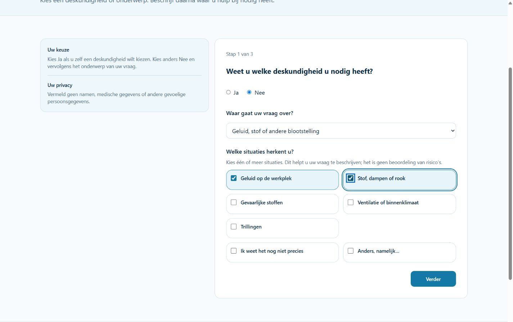
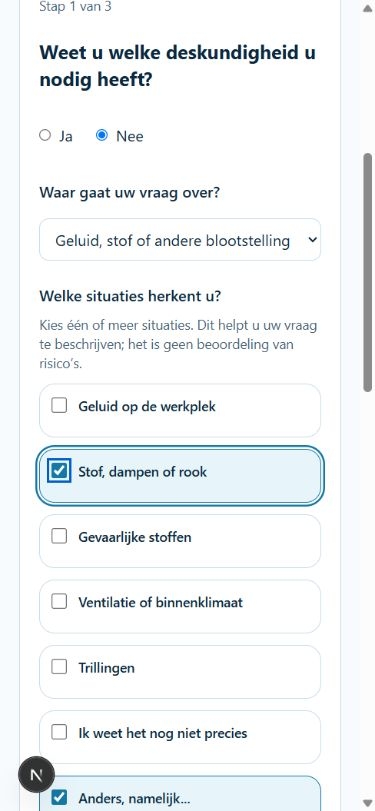

# Thema-afhankelijke situaties bij Opdracht starten

Datum: 25 oktober 2026. Basis: `dce0cdae2f326c03f54a47741d6977d2c6b56343`.
Status: implementatie en gerichte validatie afgerond; inhoudelijke Product Owner-review blijft onderdeel van de Draft PR. De bestaande standalone TypeScript-baseline blijft afzonderlijk open.

## Gedrag en scope

Route B blijft Nee → bestaand onderwerp → situaties → dezelfde omschrijving, uitvoering, start en publicatie. De drie hoofdstappen blijven behouden; de extra vraag staat onder de onderwerpselectie. Route A, de twintig deskundigheden, aanvullende-expertisematrix en matching blijven gelijk.

De situatiekaarten zijn volledige labels met native checkboxen, één kolom onder 768 px en twee gelijke kolommen vanaf 768 px. De grid rijhoogte strekt beide kaarten uit. Onbekend is exclusief; Anders mag met inhoudelijke opties worden gecombineerd en vereist voor doorgaan/publicatie maximaal 500 tekens toelichting. Bij teruggaan, herladen en de bestaande expliciete login-overdracht blijven geldige keuzes behouden. Thema-/routewisseling verwijdert de niet meer toepasselijke situatiekeuzes en de bijbehorende Anders-toelichting; overige opdrachtvelden blijven behouden.

## Inhoudelijke herkomst

`src/lib/requests/topic-situations.ts` bevat uitsluitend beschrijvende context op basis van de bestaande `helpTopicLabels`, `src/content/simple-advice-context.ts` en de daarin hergebruikte dienstbeschrijvingen. De expliciete voorbeelden voor blootstelling uit de Product Owner-opdracht zijn overgenomen. Geen nieuwe juridische eisen, risico-oordelen, deskundigheidsclassificaties of uitsluitingsregels.

| Bestaand thema | Inhoudelijke situaties |
| --- | --- |
| RI&E | Opstellen, actualiseren, plan van aanpak, toetsing |
| Veilig werken / veiligheidsbeleid | Beleid, dagelijkse praktijk, maatregelen, ondersteuning preventiemedewerker |
| Machines en arbeidsmiddelen | Afscherming, veilig gebruik, onderhoud, aanpassing |
| Gevaarlijke stoffen | Stoffenoverzicht, opslag, etiketten/veiligheidsinformatiebladen, werken met stoffen |
| Geluid, stof of andere blootstelling | Geluid, stof/dampen/rook, stoffen, ventilatie/binnenklimaat, trillingen |
| Werkdruk, stress of ongewenst gedrag | Werkdruk/stress, samenwerking, ongewenst gedrag, vertrouwelijke ondersteuning |
| Ziekte, verzuim of re-integratie | Hoog verzuim, langdurig verzuim, werkhervatting, verzuimproces |
| Ergonomie / fysieke belasting | Werkplekinrichting, tillen/duwen/trekken, werkhoudingen, repeterend werk |
| Ongeval of incident | Arbeidsongeval, bijna-ongeval, omstandigheden onderzoeken, leren van incident |
| BHV / noodsituaties | Organisatie/bezetting, ontruiming, oefenen, training/instructie |
| Brandveiligheid | Vluchtroutes, compartimenten, installaties, voorzieningen |
| Explosiegevaar / ATEX | Atmosferen, ontstekingsbronnen, zones, document |
| Keuring of certificering | Periodieke keuring, technische inspectie, certificering, conformiteit |
| Anders / Ik weet het echt niet | Bestaande vrije route blijft behouden; geen herhaalde onzekerheidsvraag |

De dertien inhoudelijke thema's bieden daarnaast “Ik weet het nog niet precies” en “Anders, namelijk...”. Die onzekerheidskeuze is geen bewijs van afwezige risico's. De twee bestaande terugvalkeuzes Anders en Ik weet het echt niet zijn geen inhoudelijke thema's: daarvoor blijft de vrije route behouden (PC-026: geen vraag herhalen waarvan het antwoord al bekend is). De bestaande optionele toelichting op het onderwerp Anders blijft behouden als eigen onderwerpomschrijving.

## Gegevenscontract en compatibiliteit

Optioneel `topicSituations` in de bestaande JSON-payload: `{ version: 1, topic, selected: [stabiele codes], otherText }`. Versie 1 legt de betekenis van de codes vast; latere semantische wijzigingen vereisen een nieuwe versie. Er wordt geen gepubliceerde IntakeQuestionnaire gewijzigd.

- Oude snapshots zonder veld blijven leesbaar, zonder verzonnen keuzes of backfill. Een hervat oud browser-/serverconcept bewaart de bestaande omschrijving; de nieuwe vraag begint onbeantwoord. Ook een oud tabconcept dat al op stap 2 of 3 stond, opent eerst deze nieuwe vraag zonder de overige invoer te wissen.
- De gedeelde Zod-validatie weigert onbekende versies/codes, duplicaten, onderwerpconflicten, onbekend met andere keuzes en losse Anders-tekst. Conceptopslag accepteert onvolledige maar niet tegenstrijdige invoer; doorgaan/publiceren vereist een keuze en, indien gekozen, Anders-tekst.
- De bestaande tabgebonden, accountgescheiden `sessionStorage` en `IntakeSimpleAdviceRevision` bewaren context. Geen nieuwe opslagplaats, tabel, cookie of tracking.
- `AdviceDossierVersion.simpleRequestSnapshot` bewaart de structured selectie. `simpleAdviceSummary` projecteert labels en toelichting naar controle en `Request.notes`; de vrije omschrijving wordt niet aangepast.
- De nieuwe `RequestAssignmentHandoff.snapshot` bevat dezelfde context onder de bestaande checksum en immutable bescherming. Assignment blijft via Request/AdviceDossierVersion herleidbaar; er komt geen tweede classificatiebron.
- Herhaalde gelijke publicatie gebruikt dezelfde Request/Assignment. Afwijkende context op dezelfde submit-ID faalt als conflict. Tenant-, audit- en snapshotbescherming blijven ongewijzigd.
- Geen automatische deskundigheid, providerselectie of mail door deze context. Route B houdt een null primary en lege additional; bestaande matchingblokkade blijft actief.

Geen schema-, migratie-, financiële of juridische regelwijziging. Bestaande productiegegevens worden niet aangeraakt.

## Wijzigingsset

- `src/lib/requests/topic-situations.ts`
- `src/lib/requests/topic-situations.test.ts`
- `src/lib/requests/simple-advice-contract.ts`
- `src/lib/requests/legacy-simple-advice-service.ts`
- `src/lib/requests/request-assignment-handoff.ts`
- `src/components/requests/topic-situation-options.tsx`
- `src/components/requests/simple-advice-form.tsx`
- `src/components/requests/simple-advice-form.test.tsx`
- `scripts/test-request-database.ts`
- `docs/simple-advice-request-flow.md`
- `docs/advice-topic-situations.md`
- `docs/evidence/advice-topic-situations/desktop.png`
- `docs/evidence/advice-topic-situations/mobile.png`
- `CHANGELOG.md`

## Validatie

### Geautomatiseerd

- `npm run test -- src/lib/requests src/components/requests src/content/simple-advice-context.test.ts src/app/advieswijzer src/app/opdracht-starten --maxWorkers=2`: **229/229 PASS, 14 bestanden**. Inclusief keuzecombinaties, exclusief onbekend, ongeldige/tegenstrijdige invoer, alle dertien thema's, vrije terugvalroutes, oude snapshots/concepten, login-overdracht, accountgescheiden opslag, Route A en deep links.
- `npm run test:db:requests`: **PASS** met synthetische fixtures in een nieuw aangemaakte lokale PostgreSQL-database via de bestaande harness. De huidige 92 migraties en referentieseed zijn uitsluitend daar toegepast. Gecontroleerd: gelijktijdige identieke publicatie geeft exact één Request, Assignment en handoff; context identiek in beide immutable snapshots; afwijkende context geeft conflict; audit, tenantautorisatie, dashboard en null primary zonder matching blijven intact. Serverconcept opslaan/heropenen en weigeren van tegenstrijdige invoer zijn eveneens getest. De harness verwijdert de tijdelijke database in `finally`; afzonderlijke controle bevestigt dat deze niet meer bestaat.
- Volledige lint: **PASS**.
- Standalone `npm run typecheck`: **BASELINE_FAILURE**, uitsluitend vier TS2345-fouten over readonly arrays in `src/lib/compliance/rule-engine.test.ts` op regels 13, 14, 23 en 24. Het testbestand en de bijbehorende rule-engine zijn gelijk aan de main-basis; geen fout uit de taakbestanden. Niet aangepast binnen deze opdracht.
- `npm run build`: **PASS**, met procesgebonden `NODE_OPTIONS=--max-old-space-size=6144`. Eerste poging stopte tijdens TypeScript op de standaard 4-GB-heapgrens. Geen configuratie- of dependencywijziging hiervoor. De bestaande Turbopack/NFT-waarschuwing rond `next.config.ts`/Knowledge-upload blijft zichtbaar.
- `git diff --check` en gerichte secrets-patterncontrole: **PASS**. Geen `.env`, lokale logs, testcredentials of gegenereerde Next-bestanden in de commitset.

### Browser

Lokale ontwikkelserver op `http://127.0.0.1:3060/opdracht-starten?start=onderwerp`, anoniem en uitsluitend fictieve invoer; geen echte publicatie of externe e-mail. De publicatieketen is aanvullend met echte PostgreSQL-transacties getest zoals hierboven.

| Controle | Resultaat |
| --- | --- |
| Desktop 1440 px | Twee gelijke kaarten van circa 316 px; kaarten per rij even hoog; geen horizontale overflow |
| Tablet 960 px | Twee gelijke kaarten van circa 221 px; langere tekst loopt om; geen overlap |
| Mobiel 390 px | Eén kolom, hele kaart klikbaar, gekozen staat zichtbaar; geen horizontale overflow |
| Reflow 720 en 320 px | Eén kolom; ook lange labels leesbaar en knoppen bereikbaar; scrollbreedte blijft binnen viewport |
| Keyboard/focus | Tab en spatie bedienen de native checkboxen; zichtbare focusring; lege keuze krijgt foutmelding en focus op de groep |
| Tekstcontrast | Gemeten kaartkleuren: 13,37:1 geselecteerd en 14,89:1 niet geselecteerd |
| Selecties/context | Meerdere keuzes; Onbekend wist overige; bekende keuze wist Onbekend; Anders combineerbaar; context zichtbaar bij omschrijving en controle |
| Navigatie/herstel | Terug, opnieuw verder en herladen behouden selectie en Anders-tekst; themawissel wist uitsluitend de oude situaties; Route A met HVK blijft werken |
| Console | Geen vastgelegde console- of hydratatiefouten tijdens de gecontroleerde flow |

De native Edge-bediening was niet bereikbaar (vensterobservatie/time-out); de echte browserzoom is daarom niet opnieuw bediend. De uitgevoerde 720-px-reflowcontrole representeert de beschikbare CSS-breedte van een 1440-px-venster op 200%, maar wordt niet als echte zoommeting gepresenteerd. De eerdere Product Owner-acceptatie van 200% als ontwerpcriterium blijft gelden; geen nieuwe handmatige goedkeuring gevraagd.

### Review en grenzen

Product Constitution: gebruikerskeuzes en onzekerheid zichtbaar (PC-008/010/048); één gedeelde validatie (PC-028); privacyhint (PC-047); immutable/idempotent (PC-056–058); native labels, focus en reflow (PC-062–064). Geen juridische uitkomst of expertise wordt afgeleid.

Inhoudelijke eindreview: bevestig de beschrijvende labels per bestaand thema en het behoud van de vrije routes voor Anders/Ik weet het echt niet. Geen nieuwe juridische of taxonomische beslissing is nodig om deze context op te slaan. De Draft PR is geen merge- of productievrijgave. De vier bestaande TypeScript-fouten staan los van deze wijziging en moeten bij een latere mergebeslissing expliciet worden meegenomen.
