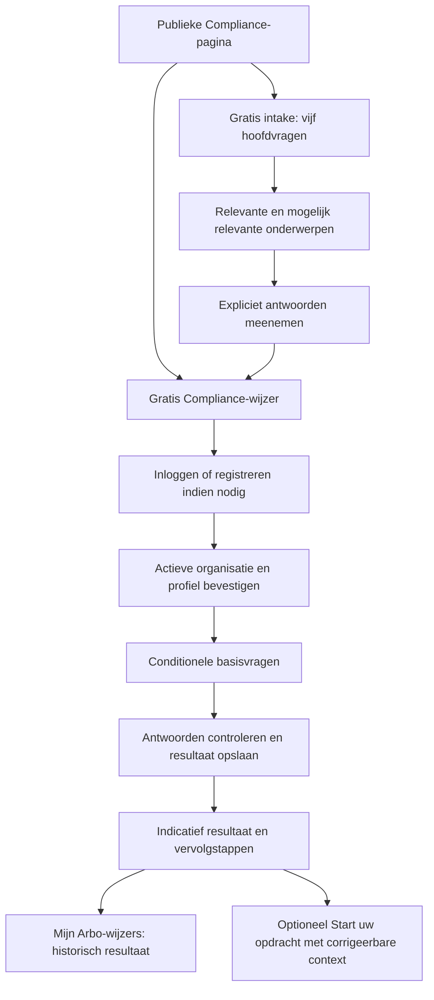

# Functioneel ontwerp Compliance-producten

Status: **ONTWERP — Product Owner-goedkeuring vereist vóór implementatie**. Onderzocht op 15 oktober 2026. Basis: actuele `origin/main` `d3bce31248cf496f4c0563e210addbcb8d2e721c`. Dit document verandert geen runtime, gepubliceerde vraagset, database of bestaande beoordeling.

GitHub: [issue #41](https://github.com/WorkMatchr/platform/issues/41). Afhankelijkheid: afzonderlijke [A07 Draft PR #40](https://github.com/WorkMatchr/platform/pull/40).

Lees samen met de [vraagcatalogus en bronverantwoording](compliance-product-question-catalog.md), [Compliance-wijzer v1](compliance-guide-v1.md), [runfundament](arbo-guide-run-foundation.md), [architectuurpreflight](arbo-compliance-scan-v1-architecture-preflight.md) en [Product Constitution](PRODUCT_CONSTITUTION.md). Waar oudere documenten anonieme rapportdownload noemen, is de huidige code leidend: de bestaande wijzer en rapportopslag vereisen een actieve organisatiecontext.

## 1. Productbesluit en grenzen

| Product | Toegang | Uitkomst | Beschikbaarheid in het ontwerp |
|---|---|---|---|
| Gratis intake | Geen account, vijf hoofdvragen | Mogelijk relevante arbo-onderwerpen; geen complianceoordeel | Publieke oriëntatie |
| Gratis Compliance-wijzer | Gratis account met bestaande actieve organisatiecontext | Indicatieve basisbeoordeling, concrete vervolgstappen en bewaard resultaat | Gratis; geen betaalrecht nodig |
| Uitgebreide Compliance Scan | Later afzonderlijk te autoriseren | Verdieping van uitzonderingen, bewijs, prioriteit en rapportage | Toekomstig; geen bestelknop of beschikbaarheidsclaim |

€24,95 per scanronde blijft het opgegeven productuitgangspunt voor de toekomstige scan. Btw-presentatie, rondedefinitie, herkansing en eventuele oude kortingsvoorstellen zijn geen nieuwe besluiten in dit ontwerp. Geen financiële configuratie wijzigen. Gratis bevindingen worden niet achter een betaalmuur verstopt.

2–3 minuten voor de intake en 15–20 minuten voor de wijzer zijn **nog te meten hypotheses**. Niet als bewezen snelheid publiceren. De brede vierde intakevraag kan de korte invultijd juist onder druk zetten.

## 2. Nulmeting: wat bestaat daadwerkelijk?

| Onderdeel | Bewijs op main | Gevolg |
|---|---|---|
| Gratis intake | `src/lib/compliance/free-intake.ts`: FI-01 t/m FI-15, versie 1.0; `free-intake-applicability.ts`: C01–C10 en R01–R23 | Nieuwe vijfvraagset is een nieuwe versie; geen hergebruik van oude codes met gewijzigde betekenis |
| Huidige wijzer | `src/components/public/compliance-guide.tsx`: 21 vraagdefinities, daarnaast `employeeCount` en `representation` | 21 is niet het totaal aantal invoervelden; zie catalogus |
| Bestaande beoordeling | `src/lib/compliance-guide/compliance-guide.ts`: negen resultaten en vier statussen | Geen stille vervanging of herinterpretatie van historische vierstatusrapporten |
| Nieuwere foundation | `rule-engine.ts`, `module-aggregation.ts`, `c01-rie.ts`, `c01-rie-assessment.ts` | Vijfstatussemantiek bestaat al naast legacy; C01 heeft twaalf aanvullende/detailvraagdefinities, niet automatisch nog eens toevoegen |
| Regelvoorwaarden | `notEquals` en `not` kunnen waar zijn bij afwezige invoer | Nieuwe positieve/NVT-regels moeten expliciete aanwezigheid en toegestane positieve waarden toetsen |
| Applicability | `free-intake-applicability.ts`: niet-geselecteerd risico kan bij bekende groep `NOT_APPLICABLE` worden | Die gevolgtrekking is niet veilig voor de compacte brede checklist; versie 2 moet conservatiever zijn |
| Werkgeverschap | Legacy wijzer maakt bij `hasEmployees=NO` alle negen onderdelen NVT; vrije intake houdt C-modules mogelijk relevant | Niet overnemen als algemene vrijstelling; ook werk onder gezag, derden en zelfstandigen vereisen begrenzing |
| Opslag | `arbo-guide-run-service.ts`, Prisma `ArboGuideRun`/`ArboGuideRunResult`: tenant, idempotentie, snapshots, fingerprint, seriële transactie | Bestaande root behouden; geen tweede Assessment-root |
| Beperkte snapshots | `answersSnapshot`-validator accepteert scalars, geen arrays; report schemaVersion 1 accepteert vier statussen | Meerkeuze/context en vijf statussen vragen een expliciete nieuwe schema-/rapportversie |
| Frameworks | Prisma `ComplianceFrameworkVersion`, modules, vragen, opties, regels en KnowledgeClaim-bindingen bestaan | Modelaanwezigheid bewijst niet dat 46 vragen gepubliceerd of operationeel zijn; seed bevat modulefundament |
| Acties | `ensureComplianceActionsForRun` maakt alleen voor `EXTENDED` en ACTION/CHECK operationele acties | Gratis opgeslagen **aanbevolen vervolgstappen** kunnen al in rapportsnapshot; voortgang/toewijzing voor BASIC is een apart besluit |
| Auth | `arbo-guide-access.ts` + runservice valideren actieve gebruiker/membership/organisatie; platformorganisatie uitgesloten | Gratis account alleen is nu onvoldoende zonder organisatie; bestaande autorisatie behouden |
| Publieke verwijzingen | `public-routes.ts`: `/wijzers/compliance` en `/wijzers/compliance/scan`, navigatietekst “Arbo Compliance Check”; beide pagina's noemen vijftien profielvragen | Later gerichte copy/metadata-update, geen wijziging van opdrachtstart of de twintig expertises |

### Bevestigde bestaande blockers en beperkingen

1. **Opslagcontract:** `/wijzers/compliance/runs/route.ts` roept `completeArboGuideRun` zonder `complianceFrameworkVersionId` aan; die service weigert COMPLIANCE zonder dit veld vóór de transactie. Dit is een concrete statische contractbreuk op main, geen bewijs van een in deze ronde uitgevoerde productiepublicatie. De route-unit-test mockt de service en kan dit missen. Eerst een geïntegreerde regressie en versiecorrecte binding; nooit blind een willekeurig gepubliceerd framework kiezen dat niet bij de legacyvragen hoort.
2. **Schone migratiereplay:** `20261001113000_add_compliance_domain_versioning_foundation/migration.sql` bevat op regels 215/250 `AS $` / `$;`. A07 heeft P3018/42601 al op een tijdelijke lokale database gereproduceerd. Hier alleen de bron opnieuw gecontroleerd; niets uitgevoerd of herschreven. Afzonderlijk historisch verantwoord herstel vereist, inclusief toegepaste SQL/checksums per bekende omgeving.
3. **Vierstatusprojectie:** C01 zet zowel `ATTENTION_REQUIRED` als `NOT_ASSESSED` om naar legacy `CHECK`. De nieuwe vijfdelige dashboardtelling mag deze verliesgevende mapping niet als bron gebruiken.
4. **Scope van bewijs:** geen productiegegevens gelezen, geen aantallen opgeslagen runs vastgesteld, geen claim dat volledige DB/browseracceptatie groen is. De vier bestaande readonly-arraytypefouten uit A07 zijn gerapporteerde baseline, niet opnieuw gemeten in deze documentatieronde.

## 3. Definitieve formulering van de vijf intakevragen ter goedkeuring

“Definitief” betekent hier een volledig gespecificeerd voorstel, nog geen gepubliceerde vraagset. Versie-identiteit: `FREE_INTAKE/2.0`, codes `FI2-01` t/m `FI2-05`.

### FI2-01 — Heeft uw organisatie personeel?

Eén keuze: **Ja, werknemers in dienst** (`EMPLOYEES`); **Geen werknemers in dienst, wel andere mensen die onder onze leiding werken** (`OTHERS_UNDER_AUTHORITY`); **Alleen vrijwilligers** (`VOLUNTEERS_ONLY`); **Nee, ook geen andere mensen onder onze leiding** (`NONE`); **Dat weet ik niet** (`UNKNOWN`). Toelichting: denk ook aan uitzendkrachten en stagiairs; geen namen invoeren. Dit is een feitelijke scopevraag, geen verzoek aan de gebruiker om een juridische werkgeverskwalificatie te geven.

EMPLOYEES activeert kernonderwerpen; overige antwoorden houden mogelijk toepasselijke onderdelen open. NONE geeft nooit een algemene “geen arboverplichtingen”-uitkomst. Vrijwilligers zijn geen generieke vrijstelling voor alle risico's.

### FI2-02 — In welke sector is uw organisatie actief?

Meerdere keuzes uit de bestaande publieke labels: **Bouw, Industrie, Zorg, Onderwijs, Logistiek en transport, Zakelijke dienstverlening**; daarnaast **Andere sector** (`OTHER`) en exclusief **Dat weet ik niet** (`UNKNOWN`). Geen nieuw vrijtekstveld of nieuwe canonieke sectortaxonomie. Technische mapping hergebruikt de bestaande sectoridentiteiten; dit zijn brede oriëntatiecategorieën, geen volledige SBI-classificatie. Sector kan onderwerpen toevoegen/ordenen, maar sluit nooit zelfstandig een risico uit.

### FI2-03 — Hoeveel werknemers heeft uw organisatie?

Eén keuze: **0, 1–25, 26 of meer, Dat weet ik niet** (`ZERO`, `ONE_TO_25`, `MORE_THAN_25`, `UNKNOWN`). Bij FI2-01 zonder werknemers kan 0 als zichtbaar corrigeerbaar voorstel worden getoond; niet opnieuw verplicht vragen. Tegenstrijdigheid geeft een herstelvraag binnen dit scherm, zonder stil overschrijven. Aantal personen, niet FTE. Personen onder leiding blijven afzonderlijk uit FI2-01 bekend. De grens van 25 bepaalt nooit zelfstandig een toetsingsvrijstelling.

### FI2-04 — Welke werkzaamheden en arbeidsrisico's komen voor?

Eén meervoudige checklist met visuele subgroepen, niet vijftien verborgen hoofdvragen. Vraag: “Kies wat u herkent. U hoeft niet zeker te weten of een situatie een risico oplevert.” Opties:

| Groep | Vaste antwoordopties (code → zichtbaar label) |
|---|---|
| Werkplekken | `HOME` → thuiswerk; `MULTIPLE_LOCATIONS` → meerdere locaties; `THIRD_PARTY_LOCATIONS` → werken bij anderen; `DISPLAY_SCREEN` → beeldschermwerk; `WORKPLACE_SETUP` → bijzondere inrichting van de werkplek |
| Fysieke veiligheid | `MACHINES` → machines; `WORK_EQUIPMENT` → andere arbeidsmiddelen; `VEHICLES` → voertuigen/mobiele werktuigen; `HEIGHT` → werken op hoogte; `ELECTRICAL` → elektrische werkzaamheden; `PRESSURE` → drukapparatuur/perslucht; `RADIATION` → straling; `FIRE` → werkzaamheden met brandgevaar |
| Blootstelling/belasting | `HAZARDOUS_SUBSTANCES` → gevaarlijke stoffen; `BIOLOGICAL_AGENTS` → biologische blootstelling; `ATEX` → mogelijk ontplofbare atmosfeer; `PHYSICAL_LOAD` → tillen/duwen/repetitief werk; `NOISE` → lawaai; `VIBRATION` → trillingen; `CLIMATE` → hitte/kou |
| Organisatie van werk | `PSA` → werkdruk of ongewenst gedrag; `LONE_WORK` → alleenwerk; `NIGHT_OR_SHIFT` → nacht-/ploegendienst of afwijkende tijden; `YOUNG_WORKERS` → werk door jongeren onder 18; `PREGNANCY_WORK_RISK` → werk dat extra aandacht vraagt bij zwangerschap/borstvoeding |

Aanvullend **Ik herken geen van deze situaties** (`NONE_RECOGNIZED`, exclusief), **Dat weet ik nog niet** (`UNKNOWN`, exclusief), en **Er kunnen nog andere situaties spelen** (`OTHER`, combineerbaar). Geen vragen over wie zwanger/ziek is. De optie gaat over het werk, niet over medische personeninformatie. Geen vrije tekst.

Alleen gekozen positieve signalen maken een risico RELEVANT; niet gekozen, NONE_RECOGNIZED, OTHER en UNKNOWN leveren geen bewijs van afwezigheid. Niet-herkende risico's blijven POSSIBLY_RELEVANT. R02/PBM blijft een mogelijke maatregelvraag, geen automatisch bewezen PBM-plicht uit een vinkje. PSA-basisvragen blijven voor werkgevers zichtbaar, ook zonder PSA-vinkje.

Positieve mapping (alles uitsluitend oriëntatie): R01 ← MACHINES/WORK_EQUIPMENT; R03 ← HAZARDOUS_SUBSTANCES; R04 ← PHYSICAL_LOAD; R05 ← DISPLAY_SCREEN/HOME; R06 ← PSA; R07 ← NOISE; R08 ← VIBRATION; R09 ← HEIGHT; R10 ← YOUNG_WORKERS; R11 ← PREGNANCY_WORK_RISK; R12 ← BIOLOGICAL_AGENTS; R13 ← LONE_WORK; R14 ← NIGHT_OR_SHIFT; R15 ← THIRD_PARTY_LOCATIONS; R16 ← VEHICLES; R17 ← CLIMATE; R18 ← WORKPLACE_SETUP/DISPLAY_SCREEN/HOME; R19 ← FIRE/ATEX; R20 ← ELECTRICAL; R21 ← RADIATION; R22 ← PRESSURE; R23 ← ATEX. R02 blijft mogelijk relevant totdat een maatregelbeoordeling plaatsvindt. MULTIPLE_LOCATIONS informeert C01/C05 over dekking en organisatie, zonder eigen risicomodule. Iedere module zonder positief signaal blijft mogelijk relevant; geen ontbrekende mapping wordt NVT.

### FI2-05 — Waarover wilt u vooral inzicht krijgen?

Meervoudig: **RI&E en plan van aanpak; Preventiemedewerker; BHV; Bedrijfsarts en basiscontract; PAGO; Voorlichting en veilig werken; Werkdruk en ongewenst gedrag; Arbeidsongevallen; Betrokkenheid van werknemers; Andere arbeidsrisico's**. Exclusief: **Ik wil een algemeen overzicht** en **Dat weet ik nog niet**. Technische codes uit deze nieuwe vraagset verwijzen naar bestaande C-/R-modules. Interesse bepaalt alleen presentatievolgorde, nooit wettelijke toepasselijkheid, volledigheid of een automatisch groen resultaat.

### Verliesanalyse FI-01–FI-15

| Bestaande vraag | Nieuwe bestemming | Verlies/gevolg |
|---|---|---|
| FI-01 personeel | FI2-01 | Meer onderscheid; geen oude NO→NVT-regel kopiëren |
| FI-02 aantal | FI2-03 | 0 toegevoegd; geen FTE of 40-urengrens afleiden |
| FI-03 locaties | FI2-04 HOME/MULTIPLE_LOCATIONS/THIRD_PARTY_LOCATIONS | Negatief bewijs per groep vervalt; niet-aangevinkt blijft onzeker |
| FI-04 middelen/voertuigen | FI2-04 MACHINES/WORK_EQUIPMENT/VEHICLES | Idem |
| FI-05 stoffen/biologisch/ATEX | FI2-04 gelijknamige codes | Idem; geen automatische vrijstelling |
| FI-06 fysieke belasting/beeldscherm/inrichting | FI2-04 gelijknamige codes | Idem |
| FI-07 PSA ja/nee/onbekend | FI2-04 PSA | Expliciet NO verdwijnt; PSA-basis wordt nooit verborgen op deze grond |
| FI-08 geluid/trilling/klimaat | FI2-04 gelijknamige codes | Niet-selectie blijft onzeker |
| FI-09 hoogte/elektra/druk/straling | FI2-04 gelijknamige codes | Niet-selectie blijft onzeker |
| FI-10 alleen/nachtwerk | FI2-04 gelijknamige codes | Niet-selectie blijft onzeker |
| FI-11 jongeren | FI2-04 YOUNG_WORKERS | Harde NO→R10-NVT niet meer beschikbaar |
| FI-12 zwangerschapsgerelateerd werk | FI2-04 PREGNANCY_WORK_RISK | Harde NO→R11-NVT vervalt; geen medische data afleiden |
| FI-13 RI&E aanwezig | Bestaande wijzervraag `rie` | Verdwijnt uit oriëntatie; geen tekortkomingssignaal uit intake |
| FI-14 PvA/preventie/arbodienst samen | Afzonderlijke bestaande wijzervragen | Gebundeld oordeel verdwijnt; niet automatisch overnemen als drie JA-antwoorden |
| FI-15 BHV/werknemersbetrokkenheid samen | Afzonderlijke bestaande wijzervragen | Idem; bestaande `coreSignals`/teaser moet versiegebonden worden vervangen |

Geen risico-informatie verzinnen uit sector, interesse of oude onbeantwoorde velden. Het ontwerp bewaart positieve signalen en onzekerheid; het bewaart bewust niet alle oude negatieve zekerheden. R01–R23 en C01–C10 blijven dezelfde taxonomie. Bij Q4-clustering worden geen modules toegevoegd of verwijderd.

## 4. Nieuwe gebruikersstroom en pagina

De publieke `/wijzers/compliance` krijgt twee gelijkwaardige productkaarten. Links **Gratis intake**, vijf vragen, geen account, oriëntatie, **Start gratis intake** naar bestaande `/wijzers/compliance/scan`. Rechts **Compliance-wijzer**, maximaal 46 vragen volgens telafspraak hieronder, gratis account en resultaten bewaren; **Inloggen** en secundair **Gratis account maken** met bestaande veilige returnTo-route. Voor een bevoegde ingelogde gebruiker wordt dit **Start Compliance-wijzer**. Voorstel: gebruik een expliciete `?start=wijzer`-UI-ingang op dezelfde bestaande route, zonder antwoorden/tenant-ID in URL. Auth is server-side, query is geen toegangsbewijs. Definitieve routekeuze is nog goed te keuren.

Onder de kaarten: “Uitgebreide Compliance Scan — in voorbereiding. Een toekomstige verdieping met nadere onderbouwing en prioritering. Nog niet beschikbaar.” Geen aankoop of schijnbaar werkende betaalflow. Bestaande `/scan`-URL blijft voor gratis intake behouden; geen bestaande bookmark stil naar betaling sturen.

Desktop twee kaarten; bij onvoldoende effectieve breedte één kolom (ook tablet waar nodig en desktop met 200%-zoom). Bestaande ArboGuide-layout/tokens/CTA's. DOM-volgorde links→rechts; fieldsets/legends, zichtbare focus, foutassociatie, stapfocus, reduced-motion, geen uitsluitend kleurgedragen status. Geen testimonials, nieuwe navigatie of redesign buiten deze productpresentatie.

### Overdracht en A07

A07 Draft PR #40 staat bij controle op `70374ed71f195feef3feca1549c48c5a9ad567fd`; niet gemerged. Deze documentatiebranch raakt geen A07-bestand. Implementatie integreert eerst de goedgekeurde A07-opslaghelper; niet kopiëren of een parallel auth-/opslagmechanisme bouwen.

- Alleen vaste profielcodes meenemen na **Gebruik deze antwoorden in mijn Compliance-wijzer**. Toon daarna samenvatting met wijzigen/weigeren. Beoordelingsantwoorden niet uit voorkeuren afleiden.
- Binnen dezelfde SPA kan overdracht uit geheugen. Voor een reload, nieuwe tab of loginredirect expliciet dezelfde A07-opt-in voor bewaren maximaal 24 uur aanbieden. Zonder opt-in eerlijk melden dat antwoorden bij herladen verloren kunnen gaan; niet stiekem sessionStorage/cookie/serverdraft toevoegen.
- Geen antwoorden in URL, analytics, authlogs of returnTo. Alleen vertrouwde relatieve returnTo; daarna schema/versie/TTL opnieuw controleren.
- Het bestaande startgate heeft voor registratie alleen `/registreren`; behoud van de bedoelde terugkeer is dus een te testen uitbreidingspunt, geen reeds bewezen werking. Hergebruik de veilige returnTo-validatie door registratie/activatie heen, zonder antwoorden of tenantkeuze te vertrouwen.
- Voor serveropslag actieve organisatie benoemen en bevestigen; lokaal concept bewijst geen eigenaarschap. Bij account-/tenantwisseling niet automatisch importeren. Weigeren laat de servergeschiedenis ongemoeid.
- Oude FI1-positieve signalen mogen na expliciete keuze voorgesteld worden; geen sector/interesse verzinnen; geen gebundeld FI14/15-antwoord splitsen. A07 v1 zonder betrouwbare datum blijft hervatten/verwijderen. Opslagenvelopversie en vraagsetversie zijn verschillende dimensies: toekomstige envelop krijgt een expliciete `questionnaireVersion`, zonder `savedAt` te vernieuwen bij conversie.
- A07-invariant blijft: standaard geheugen, expliciet 24 uur vanaf bewaren, geen verlenging door bekijken/bewerken, actieve invoer blijft bij expiry, gerichte logoutwaarschuwing en wissen, herstel na mount zonder 418. Geen algemene sessie-intrekking.

## 5. Beoordeling en resultaatdashboard

Catalogus: 21 bestaande vraagdefinities als uitgangspunt plus 25 gerichte aanvullingen. Daarvan is `hasEmployees` een profielvraag: **45 inhoudelijke vragen + 1 profielbevestiging**, naast de twee bestaande contextvelden. “Maximaal 46” is dus geen belofte van 46 radiogroepen inclusief onboarding en alle subvelden. Maak het aantal nog te beantwoorden inhoudelijke vragen dynamisch; stel nooit een duplicate om het getal te halen. Zie catalogus voor overlap en scope.

Applicability vóór beoordeling. Onbekend, ontbrekend, ongeldig, conflicterend of overgeslagen is geen JA en geen NVT. Bij onbekende toepasselijkheid blijft de vraag beschikbaar met “Dat weet ik niet”; geen automatische uitsluiting. Bij expliciete parent-NO mag detail worden verborgen, maar dat is `SKIPPED_DEPENDENCY`, niet “Niet van toepassing”; de ontbrekende parentvoorziening blijft een concrete tekortkoming.

Regelvoorrang voor een onderwerp: bevestigde tekortkoming → **Actie vereist**; anders concrete verbeterbevinding → **Aandacht nodig**; anders ontoereikende informatie → **Niet beoordeeld**; alleen alle vereiste toepasselijke controles positief → **Op orde**. **Niet van toepassing** alleen na volledige positieve uitsluitingsregel en zonder tegenstrijdige relevantie. Een onvolledig onderwerp kan tegelijk een rode bevinding en `sufficientlyAssessed=false` hebben; toon beide. Vrije intake geeft nooit deze vijf oordelen, alleen oriëntatie.

Voorstel dashboard: tien basisonderwerpen (oude negen, RI&E/PvA gesplitst en PSA toegevoegd, algemeen arbobeleid onder C01-samenvatting; geen dubbele telling). C07-verzuim wordt niet alsnog volledig beoordeeld uit de beperkte basiscontractvragen. Risicoverdieping R01–R23 buiten R06/PSA staat afzonderlijk als **niet inhoudelijk beoordeeld**, niet in de basisnoemer. Catalogus koppelt alle oude velden expliciet aan deze tien onderwerpen.

Samenvatting toont vijf aantallen die samen het aantal basisresultaten vormen. “Voldoende beoordeeld” telt alleen voldoende onderbouwde toepasselijke onderwerpen; NVT en onvolledige rode onderwerpen apart tonen. Geen compliancepercentage of alles-groenlabel. Per onderwerp: status met tekst/icoon, antwoordbasis, ontbrekende informatie, bevinding, concrete actie, grondslag en broncontroledatum. Aanbevelingen expliciet onderscheiden van wettelijke tekorten. Een antwoord JA is een zelfverklaring, geen gecontroleerd bewijs.

Acties eerst naar ernst en vervolgens stabiele onderwerpvolgorde; geen wettelijke deadline verzinnen. Resultaatheader bevat organisatie, datum, rapportnummer, methodiekversie en indicatieve begrenzing. Basis-PDF en historie uit dezelfde immutable snapshot. **Opnieuw beoordelen** maakt een nieuwe run; **Actie afgerond** verandert nooit de oude beoordeling. Voor deze gratis versie zijn opgeslagen aanbevolen acties onderdeel van het rapport; eigenaar/deadline/voortgang blijven een apart PO-besluit omdat de bestaande operationele service EXTENDED vereist.

Optionele ondersteuning: link naar bestaande dienst/deskundige en **Start uw opdracht** met bestaande corrigeerbare kenniscontext. Geen automatische professionalmatching, opdrachtpublicatie of volledige antwoordenoverdracht zonder aparte handeling.

## 6. Technische impact en versiebeheer

| Laag | Voorstel voor latere implementatie | Vereist bewijs |
|---|---|---|
| Intake | Nieuwe FI2-config en conservatieve applicability; FI1-parser behouden voor expliciet herstel | Alle vijftien oude velden gemapt; geen niet-selectie→NVT; correlatie/sectorsignalen geen wettelijke conclusie |
| Vraagconfig | Bestaande complianceconfig uitbreiden, centrale zichtbaarheid/validatie/voortgang; geen tweede wizardengine | Unieke codes/volgorde, conditionele waarheidstabel, verborgen waarden tellen niet mee |
| Evaluatie | Versiegebonden adapter van bestaande velden naar vijfstatusengine; regels uit catalogus | Legacy v1-uitkomsten onveranderd; UNKNOWN/partial/conflicten/negatie getest |
| Runcompletion | Frameworkversie passend bij vragen vastzetten; server berekent resultaat; transactionele completion hergebruiken | Route→echte service-integratietest, geen clientstatusvertrouwen, retry exact één run |
| Rapport | SchemaVersion 2 met vijf exacte assessmentstatussen en compleetheidsinformatie; schemaVersion 1 leesbaar houden | Oude snapshots/PDF blijven leesbaar, geen parsing met nieuwste schema afdwingen |
| Resultaatprojectie | Additief exact vijfstatusveld of uitbreiding enum na expliciete schema-review; legacyvelden behouden | Geen CHECK-terugvertaling naar een verzonnen specifieke status; nul historische updates |
| Antwoorden | Versiegediscrimineerde beperkte scalar/array-contextstructuur; canonieke sortering van set-antwoorden vóór hash | Zelfde set in andere volgorde zelfde fingerprint; oude fingerprint onveranderd |
| Historie | Bestaande ArboGuideRun als root, versie-bindingen en Knowledge-revisies | Nieuwe gepubliceerde versie verandert oude uitkomst/bronnen/titel/label niet |
| Auth/opslag | A07helpers hergebruiken; account + organisatieguards behouden | Drie synthetische rollen, cross-tenant weigering, 24h/7d/legacy/logout/multitab/418-regressies |
| Publiek | Alleen Compliance-pagina, routes-content, metadata en toepasselijke links | Geen gratis/betaald-verwarring; canonicals/sitemap, contrast en focus |

Nieuwe vragen/regels/normalisatie krijgen een nieuwe guideVersion en frameworkversie; reportVersion en schemaVersion stijgen bij betekenis-/structuurverandering. Productcode (gratis wijzer versus betaalde scan) opnemen in versiecontract en snapshot; BASIC/EXTENDED alleen is geen betrouwbaar betaalrecht. Geen nieuw betaalmechanisme in deze fase.

Bewaar bestaande snapshots en referenties byte-inhoudelijk waar mogelijk; oude evaluators/readers blijven beschikbaar. Geen bulkherberekening, backfill of overschrijving. Nieuwe opt-inbeoordeling maakt een nieuwe run en claimt geen automatische vergelijkbaarheid tussen versies. Een lopend oud concept blijft gekoppeld aan zijn vraagset; expliciet opnieuw starten of compatibele hervatting met zichtbare ontbrekende antwoorden, nooit geruisloos upgraden.

Frameworkpublicatie valideert complete vraagset, regeldekking, bronrevisies, checksum, condities en statusmapping. Published/retired config blijft immutable. Bronregister koppelt later echte bestaande KnowledgeClaim-identiteiten; geen verzonnen UUID's of “gevalideerd”-status. Versie 2-regels worden niet in het bestaande `NL_ARBO/2026-10` object overschreven.

Migraties nu: **geen**. Later uitsluitend additieve, gereviewde Prisma-migraties; eerst onafhankelijk herstel van bestaande replayblocker. Geen bestaande migratie aanpassen zonder bewijs over toegepaste geschiedenis. Rollback: nieuwe starts uitschakelen; oude en nieuwe rapportreaders behouden; geen destructive down-migration of terugzetten van bestaande data.

## 7. Gefaseerd plan en acceptatie

| Fase | Afgebakend werk na goedkeuring | Afzonderlijke acceptatie |
|---|---|---|
| 0 | PO-besluiten en inhoudelijke bron-/vraagreview | Alle 25 vragen uniek, juridisch versus aanbeveling; telling en productgrenzen akkoord |
| 1 | Afzonderlijke reparatie bestaande migratiereplay en legacy completion-contract | Schone tijdelijke PostgreSQL-replay, echte route→run-test, geen historische wijziging; niet combineren met UX |
| 2 | Rapport-/frameworkversie en vijfstatuscontract | V1 golden fixtures identiek; V2 roundtrip, nullable uitbreidingen, idempotentie, tenant, bronimmutability |
| 3 | Vijfvragenintake + A07-overdracht | Geen false negatives, onbekende velden, prefillcorrectie, geen stille storage, logout/multitab/TTL/SSR |
| 4 | Wijzer per onderwerp uitbreiden | 25 aanvullingen met truth tables; bronreview; conditionele zichtbaarheid identiek server/client; < of =46 inhoudelijke vragen |
| 5 | Resultaat + gratis rapport/historie | Vijf tellingen, volledigheid, geen score; opslaan/fout/herhalen; oude PDF; ondersteuning vrijwillig |
| 6 | Productkaarten/publieke copy | Desktop/tablet/390px/echte 200%, keyboard/screenreader, tijdsmeting en functionaliteit door PO |
| 7 | Toekomstige betaalde scan | Afzonderlijke opdracht, prijs/entitlement/financiële autorisatie; geen onderdeel van deze implementatiegoedkeuring |

Testmatrix vóór latere release: 0/1/25/26 werknemers; onder-gezag/vrijwilligers; ontbrekend/tegengesteld profiel; geen herkende risico's; PSA niet aangevinkt; jongeren onbekend; branches met ontbrekend/ongeldig/verlopen instrument; 40-urengrens onbekend; parent-NO en verborgen oude JA; onbekende vraagcode; twee tabbladen; storagefout/expiry tijdens invoer; verlopen sessie; dubbel afronden; verkeerde tenant; bronversie-update; historische PDF; losse v1/v2-readers; BASIC zonder betaalrecht. Geen tests groen maken door bestaande safetyassertions te verwijderen.

## 8. Open Product Owner-besluiten

1. Akkoord op deze vijf formuleringen en de brede Q4-checklist; invultijd eerst meten. Voorstel bewaart onzekerheid in plaats van kunstmatig alle negatieve signalen te reconstrueren.
2. Bevestig telconventie: 45 inhoudelijke vragen + profielbevestiging; twee bestaande contextvelden tellen niet als inhoudelijke beoordeling. Geen claim van maximaal 46 totale formuliercontrols.
3. Akkoord op tien basisresultaten, PSA als basis en C07/R01–R23-verdieping zichtbaar buiten de beoordeelde scope.
4. Gratis account **met actieve organisatie** behouden, of toekomstige aparte autorisatieopdracht voor persoonlijk gebruik. Geen omzeiling in dit ontwerp.
5. Aanbevolen acties in gratis snapshot versus interactief actiebeheer: voorstel eerste; operationele opvolging afzonderlijk besluiten.
6. Bevestig conservatieve RI&E-uitzonderingsroute: alleen voldoende gecontroleerde feiten geven vrijstelling; geen plicht claimen waar uitzondering onzeker is. Bron-/juridische eindreview blijft nodig, zie catalogus.
7. Bevestig routes/kaartcopy en expliciete overdracht met A07-opslag. Geen nieuwe verborgen bewaartermijn; bewaartermijn serverrapporten nog afzonderlijk privacybeleid vaststellen.
8. Toekomstige scan: €24,95 is uitgangspunt, btw/rondedefinitie/kortingen/rechten niet ingevuld. Niet verkopen vóór aparte acceptatie.

## 9. Productreview en uitgevoerde controle

PC-025/026: geen dubbelvragen na bevestigde prefill; PC-027: uitzonderingsfeiten vragen, geen juridische kwalificatie eisen. PC-028/029: dezelfde conditionele definitie voor UI/server/voortgang. PC-044/047: vaste codes zonder medische namen of vrije casusbeschrijving. PC-057: historische snapshots blijven. PC-062–064: concrete latere keyboard/zoom/labels-acceptatie. PC-069–071: primaire bronnen, indicatief, geen certificeringsclaim. PC-073–075: ontwerp is geen productgereedverklaring.

“Gratis intake” is hier de uitdrukkelijk gekozen naam van een oriëntatieproduct, niet een nieuwe klantnaam voor een Opdracht (PC-011/012). Ondersteuningsflow blijft **Start uw opdracht**. Niet wijzigen: SPECIALISM v3, matching, prijzen, notificaties, A06 of A07-runtime.

Uitgevoerd: read-only code-/model-/testinventarisatie, actuele primaire bronraadpleging, bestaande vier gerichte suites **34/34 PASS** (`compliance-guide`, `free-intake-applicability`, `rule-engine`, `c01-rie-assessment`). Tests zijn een nulmeting van bestaande code, geen bewijs voor nog niet geïmplementeerde 46-vragenlogica. Alleen documentatie gewijzigd; lint, TypeScript en productiebuild niet opnieuw uitgevoerd en geen nieuwe PASS geclaimd. Geen databaseverbinding, account, mail, runtimecode, migratie, merge of deployment. Documentcontrole/diff/secretscontrole worden in de Draft PR vastgelegd.

Documentcontrole: de 21 bestaande keys in deze catalogus zijn programmatisch tegen de component vergeleken; 25 unieke nieuwe codes en verdeling 5/3/3/3/3/2/2/2/2 gecontroleerd. Lokale Markdown-bestandslinks bestaan. Secrets-patterncontrole op de drie taakdocumenten zonder treffers; geen volledige externe secretscanner geclaimd.
