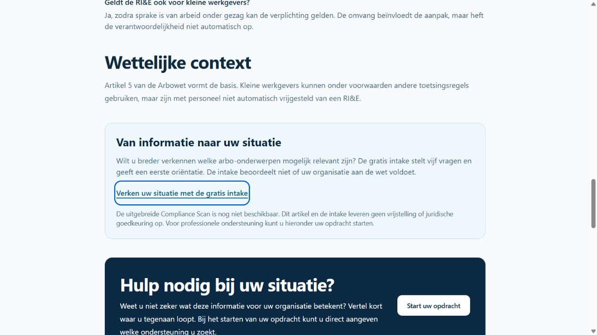
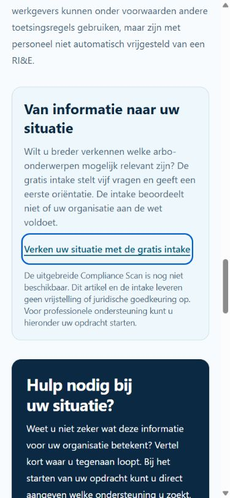

# Arbo Compliance en Kenniscentrum — technische afronding en acceptatiegrenzen

Controle: **5 november 2026**. Basis: main a315db8c7738b8862a92d9f8517b0315e3b14d1f.
Afzonderlijke branch: codex/arbo-compliance-knowledge-completion.

**GO voor review van de gerichte verbeteringen; NO-GO voor commerciële F4-activering.**
Geen claims goedgekeurd, bronrevisies verzonnen, framework gepubliceerd of productiedatabase benaderd. Geen prijs-, Academy-, navigatie-, migratie- of betaalwijziging.

## 1. Bevestigde defecten en herstel

1. De rapport-summary dedupliceert bronnen op bron-ID. Daardoor kunnen meerdere claims of revisies van dezelfde bron ontbreken. De PDF gebruikte bovendien de legacy-selectie van hoogstens één richtlijn en één aanvullende bron. De nieuwe reader haalt uitsluitend de bronnen van daadwerkelijk toegepaste regels uit de bevroren definitionSnapshot en dedupliceert op de volledige canonieke bronbinding. Zowel HTML als PDF tonen alle bindings. Een niet-herleidbare regel faalt expliciet.
2. De weergave gebruikte het algemene resultaatcontractnummer 2 als beoordelingsversie. HTML en PDF tonen nu ook de werkelijk opgeslagen frameworkcode en -versie (bijvoorbeeld 2.1), plus bronrevisie en claimreferentie.
3. De negen kennisartikelen hadden geen duidelijke route naar de bestaande gratis intake. Eén gedeelde sectie verwijst nu naar de vijfvragenoriëntatie, houdt professionele ondersteuning en gerelateerde verplichtingen intact en vermeldt dat de uitgebreide scan nog niet beschikbaar is.

De evaluator, snapshots, opgeslagen resultaten, checksumstrategie en historische v1-lezers zijn niet aangepast. Het readerherstel verrijkt de presentatie met al opgeslagen bewijs; het herberekent geen beoordeling. Artikelteksten en bestaande inhoudelijke beoordelingsdatums zijn niet opnieuw als juridisch gevalideerd aangemerkt.

## 2. Werkelijke modules en afwijking van opdrachtlabels

De opdracht gebruikt vanaf C04 andere codes dan de bestaande versiegebonden registry. Deze codes stilzwijgend vervangen zou historische betekenis wijzigen. Daarom zijn de volgende bestaande identiteiten behouden:

| Gevraagd onderwerp | Bestaande identiteit | Actuele F4-dekking / beperking |
| --- | --- | --- |
| C01 RI&E | C01 | Bestaande RI&E-/actualisatievragen; toetsingshold blijft |
| C02 Plan van Aanpak | C02 | Aanwezig; termijnen en opvolging, geen bewijscontrole |
| C03 Preventiemedewerker | C03 | Aanwezig; taakuitvoering en instemming blijven deels geblokkeerd |
| C04 BHV | **C05** | Aanwezig; geen vast generiek aantal of certificaatinterval |
| C05 PMO/PAGO | **C06 PAGO** | Aanbod en risicoaansluiting; PMO is niet automatisch PAGO |
| C06 Verzuimbeleid | **C07** | Intake-onderwerp aanwezig; geen zelfstandige F4-vragenset |
| C07 Voorlichting | **C08** | Aanwezig; instructie en toezicht |
| C08 Medezeggenschap | **C10** | Aanwezig; werkgeversscope/vertegenwoordiging blijft te beoordelen |
| C09 PSA | **R06** | Aanwezig; risicoafhankelijk, geen automatische afwezigheid |
| C10 Gevaarlijke stoffen | **R03** | Intake-onderwerp aanwezig; geen zelfstandige F4-vragenset |

F4 bevat daarnaast C04 Basiscontract/arbodienstverlening en C09 Arbeidsongevallen.
Fysieke belasting R04 en beeldschermwerk R05 bestaan als intake-onderwerp, niet als zelfstandige F4-vragenset.
F4 heeft 46 vraagdefinities plus twee contextvelden, 131 antwoordregels en tien scope-onzekerheidsregels.

### Elf C01-kerncontroles

Het bestaande C01-ontwerp bevat twaalf velden voor elf semantische controles:

| Controle | Ontwerpveld | Onderbouwing / vrijgavegrens |
| --- | --- | --- |
| Schriftelijke RI&E | Q01 | AW 5; aanwezigheid bewijst geen volledigheid |
| Werkzaamheden en locaties | Q02 | Werkelijke dekking en werkgeversscope |
| Bekende risico's | Q03 | Risico-inventarisatie; ontbrekende selectie geen vrijstelling |
| Evaluatie en prioritering | Q04 | Risico-evaluatie; zelfverklaring geen bewijsstuk |
| Actualisatie na wijzigingen | Q05/Q05A | AW 5; aanleiding, geen verzonnen jaarlijkse vervangplicht |
| Laatste beoordeling | Q06 | Datum is signaal, geen zelfstandig nalevingsoordeel |
| Bijzondere groepen | Q07 | Concrete groepen en blootstelling vaststellen |
| Toetsingsplicht en uitzonderingen | Q08 | AW 14/AB 2.14b; alle uitzonderingvoorwaarden nodig |
| Deskundige bevoegdheid | Q08A | Werkelijke bevoegdheid en toepasselijkheid verifiëren |
| Toetsingsproces | Q09 | Proces zegt niet vanzelf dat toetsing is uitgevoerd |
| Toegang werknemers | Q10 | AW 5; feitelijke toegang onderzoeken |

c01-rie.ts is een eerdere ontwerpslice, geen aangesloten F4-runtime. Alleen het eigen bestand en tests gebruiken de evaluator/snapshotbuilder. Zijn zelfverklaarde uitzondering mag niet als publiceerbare toetsingsvrijstelling worden overgenomen. De elf controles blijven de reviewbasis; samenvoeging met F4 vereist een expliciete nieuwe beoordeelde definitie, geen in-place hernummering.

## 3. Juridische bron- en claimmatrix

Zie de aanvullende [Markdown-matrix](arbo-compliance-knowledge-review.md) en [JSON-matrix](arbo-compliance-knowledge-review.json).
Deze omvatten alle 46 claimkandidaten, 48 velden, 141 regels en negen holds. Exacte vraagteksten, opties, kandidaatfragmenten, bronrevisies en regelcondities blijven herleidbaar via de [bestaande volledige matrix](../compliance-f4-legal-matrix.json), [claimreview](../compliance-f4-claim-review.json) en [broninventaris](../compliance-f4-source-evidence.json).

De claimstatussen zijn historische waarnemingen van 18 oktober 2026: DRAFT / UNVALIDATED / HISTORICAL / OUTDATED. Ze zijn in deze opdracht niet opnieuw in productie bevraagd. Webcontrole op 5 november is geen Knowledge-import of menselijke goedkeuring. Alle relevante beslissingen blijven **PENDING HUMAN ACCEPTANCE**.

De geconsolideerde [Arbowet](https://wetten.overheid.nl/BWBR0010346/) en het [Arbobesluit](https://wetten.overheid.nl/BWBR0008498/) gaven HTTP 429. De exacte actuele geldigheidsversie en volledige artikel-/lidtekst konden daarom niet onafhankelijk worden vastgesteld. Geen wetsgeldigheidsdatum ingevuld op basis van alleen de controledatum.

| Onderwerp | Officiële controle en begrenzing |
| --- | --- |
| RI&E/PvA | [Arbeidsinspectie](https://www.nlarbeidsinspectie.nl/onderwerpen/aanleveren-rie/veelgestelde-vragen-rie): AW 5, inventarisatie/evaluatie/maatregelen; geen onvoorwaardelijke vrijstelling bij kleine omvang |
| RI&E-toetsing | AW 14 en AB 2.14b blijven exact juridisch te toetsen. Gezamenlijke arbeidsduur ≤40 uur is een andere route dan in de regel ≤25 werknemers met toepasselijk instrument/model. DGA-uitzondering, cao, branche, erkenningsduur, versie en bedrijfsspecifieke toepassing zijn afzonderlijke feiten |
| Erkenning | [Arboportaal, 4 juni 2026](https://www.arboportaal.nl/actueel/nieuws/2026/06/04/nieuwe-erkenningsprocedure-branche-rie): nieuwe procedure per 1 juni; geen nieuwe alternatieve erkenning zonder cao-partijen; bestaande erkenning tot eigen einddatum. Geen generiek JA op basis van branche alleen |
| Preventiemedewerker | [Arboportaal](https://www.arboportaal.nl/onderwerpen/ondersteuning-bij-arbowet/preventiemedewerker/wat-zegt-de-wet-over-de-preventiemedewerker): AW 13, taken/deskundigheid/tijd en voorwaarden werkgever ≤25; betrokkenheid is niet hetzelfde als vereiste instemming |
| BHV | [Arboportaal](https://www.arboportaal.nl/onderwerpen/arbozorg/bedrijfshulpverlening/wat-zegt-de-wet-over-bedrijfshulpverlening): AW 15, risicoafhankelijke organisatie en beschikbaarheid; aanwijzing alleen bewijst geen effectieve inzet |
| Basiscontract | [Arboportaal](https://www.arboportaal.nl/onderwerpen/ondersteuning-bij-arbowet/basiscontract/waar-moet-het-basiscontract-aan-voldoen): taken en toegang afzonderlijk beoordelen; een algemeen contractantwoord bewijst niet alle verplichtingen |
| PAGO | [Arboportaal](https://www.arboportaal.nl/onderwerpen/arbowet--en--regelgeving/arbobeleid/pago): AW 18, aanbod gericht op arbeidsrisico's, deelname vrijwillig; een PMO voldoet niet vanzelf |
| Voorlichting | [AW 8-verwijzing](https://www.arboportaal.nl/externe-bronnen/wetgeving/arbowet-artikel-8---voorlichting-en-onderricht) bereikbaar, maar bevat alleen een verwijzing. Exacte normtekst blijft open |
| Medezeggenschap | [Arboportaal, 29 juni 2026](https://www.arboportaal.nl/actueel/nieuws/2026/06/29/regels-voor-raadpleging-van-werknemers-aangepast-per-1-juli-2026): raadpleging per 1 juli; geen OR/PVT betekent niet geen werknemersbetrokkenheid. Geen automatische WOR-conclusie |
| PSA | [Arboportaal](https://www.arboportaal.nl/onderwerpen/psychosociale-arbeidsbelasting): AW 3/AB 2.15; werkdruk en ongewenst gedrag, feitelijke risico's en maatregelen |
| Arbeidsongevallen | [Arbeidsinspectie](https://www.nlarbeidsinspectie.nl/onderwerpen/arbeidsomstandighedenwet/arbeidsongevallen): overlijden, opname of blijvend letsel; ook later bekend geworden gevolg. Kennis/proces bewijst geen feitelijke melding; registerplicht apart |
| Verzuim | [Bedrijfsarts](https://www.arboportaal.nl/onderwerpen/ondersteuning-bij-arbowet/bedrijfsarts/rol-van-de-bedrijfsarts-bij-ziekte-en-re-integratie): rol en re-integratie. Geen complete toets van alle Poortwachtertermijnen |
| Fysiek/beeldscherm | [Fysieke belasting](https://www.arboportaal.nl/onderwerpen/fysieke-belasting), [beeldschermwerk](https://www.arboportaal.nl/onderwerpen/fysieke-belasting/computerwerk/wat-zegt-de-wet-over-beeldschermwerk): context, afwisseling en onderzoek; geen universele veilige gewicht-/tijddrempel |
| Stoffen | [Blootstelling](https://www.arboportaal.nl/onderwerpen/werken-met-gevaarlijke-stoffen/blootstellingsmeting), [CMR](https://www.arboportaal.nl/onderwerpen/risicos-gevaarlijke-stoffen/kankerverwekkende-en-mutagene-stoffen/wat-zegt-de-wet): aard/mate/duur en specifieke stofcategorie. CMR-regels zijn niet zonder meer de norm voor alle stoffen |

De negen holds blijven: RIETESTING, PREVENTIONOFFICER, PREVENTIONCONSULTATION, BHVAPPOINTED, EXPERTTASKSCOVERED, CW2-PAGO-02, ACCIDENTREGISTRATION, ACCIDENTREPORTING en CW2-ONG-01. JA/NEE/GEDEELTELIJK blijft voor deze 27 antwoordregels Niet beoordeeld. UNKNOWN/ontbrekend is nooit automatisch positief; een zelfstandig vastgestelde tekortkoming in dezelfde module blijft zichtbaar.

## 4. Bestaande publicatieketen en functionele lacunes

De actuele F2/F4-loader gebruikt de volledige Knowledge-policy via evaluateComplianceClaim en inspectComplianceFramework: directe primaire ondersteuning, review/verval, menselijke validatie, temporaliteit/conflicten, zelfstandige scopeclaim en bron-/claim-/regel-/frameworkchecksums. Alleen PUBLISHED is onvoldoende. De oudere melding dat deze integratie ontbreekt is historische context, geen actuele technische blokkade.

npx tsx scripts/check-compliance-f4-publication.ts --check is de bestaande read-only route met expliciete COMPLIANCE_REVIEW_DATABASE_URL. In de tijdelijke lege database levert deze terecht NO_GO, exit 2, 141 ontbrekende regels; er wordt niets geregistreerd. Een productiedry-run is in deze opdracht niet uitgevoerd.

| Ketenschakel | Feitelijke uitkomst |
| --- | --- |
| Gratis F3-intake | Bestaand; expliciet lokaal bewaren, 24 uur, logoutregels ongewijzigd |
| Organisatie/tenant | Server-side lidmaatschap, rol en tenant gecontroleerd; synthetische integratietests PASS |
| F4-vragen en vijf statussen | Definitie en evaluator getest, geen juridische vrijgave |
| F4 onafgemaakt opslaan/hervatten | Alleen geheugen in huidige UI; geen duurzame conceptopslag. Niet gelijkstellen aan F3-opslag |
| Intake → betaalde ronde | Geen geïntegreerde betaal-/entitlementoverdracht aangetoond; geen betaalcode toegevoegd |
| Prijs | Voorstel €24,95 per ronde per organisatie-entity vanaf 1 fte ongewijzigd; geen claim dat dit aanbod actief is |
| Afgeronde beoordelingen | Bestaande versiegebonden opslag; idempotentie en isolatie PASS |
| Historische dashboards/PDF | V1-vierstatus en v2-vijfstatus behouden; geen herberekening |
| PDF-toegankelijkheid | Taalmetadata toegevoegd, tekst extracteerbaar en visueel gecontroleerd; **StructTreeRoot ontbreekt**, dus getagde leesvolgorde/PDF-UA en echte schermlezeracceptatie OPEN |

Ontbrekende vraagsets en duurzame F4-concepten zijn product-/versiegebonden uitbreiding, geen aanleiding om stilzwijgend een nieuw betaald product, vragenversie of opslagarchitectuur te introduceren. Voor commerciële volledigheid blijven ze expliciete implementatie- en acceptatiepunten.

## 5. Kenniscentrum en routes

Alle negen artikelen behouden hun bestaande verplichting- en dienstrelaties. RI&E, preventiemedewerker, BHV, PAGO/PMO, bedrijfsarts/verzuim, PSA, ongevallen, arbeidshygiëne en incidentonderzoek hebben bestaande detailroutes. Fysieke belasting, beeldschermwerk en veiligheidsorganisatie zijn deels in bredere inhoud/onderwerpen opgenomen; er zijn geen nieuwe zelfstandige artikelen of verzonnen routes toegevoegd.

Alle 25 unieke lokale bestemmingen uit de negen artikelen, hun diensten/verplichtingen en intake/opdrachtstart geven HTTP 200. Alle zestien gebruikte bron-URL's zijn afzonderlijk bekeken: vijftien officiële voorlichtingspagina's bereikbaar; de Arbowet-alias HTTP 429. Bereikbaarheid is geen juridische claimgoedkeuring. De JSON bevat de bron-URL-inventaris.

De nieuwe sectie gebruikt huisstijlcomponenten, een echte link, herkenbare focus en een expliciete beschikbaarheidsgrens. Geen automatische overname van antwoorden of artikelscope naar F4 beloofd. Product Constitution: bestaande navigatie/rollen behouden, geen intern technisch jargon in de nieuwe CTA, geen schijnzekerheid of betaalbelofte.

## 6. Uitgevoerde validatie

- Gerichte Compliance-/Knowledge-/rapport-/publieke regressies: **511/511 tests, 32 bestanden PASS**.
- PostgreSQL 18, nieuwe tijdelijke lokale container/database met uitsluitend synthetische gegevens: **95/95 migraties, nul failed, nul onverwacht; herhaalde migratie ongewijzigd**.
- V1 echte route → service: zes gelijktijdige identieke aanvragen, één run/negen resultaten.
- F2 vijfstatus-roundtrip: zes aanvragen/één run; forged snapshots, verkeerde tenant, inactief lidmaatschap, DRAFT/RETIRED en checksumdrift geweigerd.
- F4 echte route/service: 48 velden, tien resultaten, zes aanvragen/één run; rol/tenant/lidmaatschap, conditionele zichtbaarheid, bronafwijkingen en historische snapshots gecontroleerd.
- Alleen de eigen tijdelijke testdatabase en container verwijderd. Bestaande Docker-resources ongemoeid.
- HTML/PDF-regressie: alle vier synthetische bronbindingen zichtbaar ondanks gelijk bron-ID; verschillende claims/revisies en meerdere richtlijnen behouden. Bevroren snapshot byte-identiek voor/na lezen.
- Synthetische PDF van drie pagina's gerenderd en visueel bekeken; geen afgesneden bronnen of statuslabels. Geen echte persoonsgegevens.
- Browser: lokaal productiebuild, F4/contact/LMS gesloten. RI&E-artikel op desktop 1280px en mobiel 390px; geen horizontale overflow, Tab/Shift+Tab met zichtbare outline, Enter naar werkende gratis intake. Nieuwe initiële server vereiste tijdelijke Better Auth-testsleutel; na herstel geen nieuwe consolefout waargenomen. Geen ingelogde productieaccount gebruikt.
- Echte 200%-zoom, menselijke schermlezeracceptatie en ingelogde F4-browseracceptatie zijn **niet** als PASS aangemerkt. F4 blijft gesloten.
- Volledige lint: PASS, nul errors. Standalone TypeScript: PASS, nul fouten. Productiebuild: PASS. Staged diff-check en gerichte secrets-/metadata-scan: PASS (zestien bestanden, nul bevindingen).
- Baseline: vier bestaande Next.js location.assign-lintwaarschuwingen; drie bestaande buildwaarschuwingen over dynamische filesystem-tracing in knowledge-source-manifest. PostgreSQL-test geeft bestaande pg-query-deprecationwaarschuwing. Geen verzwakte controles.

## 7. Integratie, rollback en besluiten

SEO Draft PR #96 gebruikt dezelfde mainbasis. Beide raken docs/README.md: voeg beide documentatielinks samen. De Arbo-wijziging raakt geen SEO-metadata, robots/sitemap, events, F3-interactie, gedeelde header of navigatie. Beide branches afzonderlijk houden en na integratie de publieke regressies uitvoeren. Academy-/WP18-worktrees blijven onaangeroerd.

Rollback: revert uitsluitend deze presentatie-/documentatiecommit; geen database-rollback, migratie of frameworkwijziging nodig. De bestaande gate en publicatiepolicy blijven beslissend.

Vrijgavevoorwaarden:
1. Inhoudelijk reviewer bevestigt actuele geconsolideerde bronnen, 46 claimkandidaten, 141 regelbindingen en benodigde correcties aan de negen holds. Administratieve labels vervangen geen Knowledge-goedkeuring.
2. Product Owner bevestigt de bestaande code-identiteiten en gewenste aanvullende vraagsets/concept-/betaaloverdracht. Geen impliciete goedkeuring uit technisch PASS.
3. Toegankelijke PDF-structuur, schermlezer/200%-acceptatie en integrale commerciële tenantflow afronden vóór commerciële F4-vrijgave.

**Eindadvies: gerichte herstel-PR reviewbaar; volledige Compliance-productvrijgave NO-GO.**

## 8. Gewijzigde bestanden

- docs/README.md
- docs/compliance/arbo-compliance-knowledge-completion.md
- docs/compliance/arbo-compliance-knowledge-review.md
- docs/compliance/arbo-compliance-knowledge-review.json
- src/lib/compliance/arbo-review-dossier.test.ts
- src/lib/compliance/compliance-report-sources.ts
- src/lib/compliance/compliance-report-sources.test.ts
- src/lib/compliance-guide/compliance-report-pdf.ts
- src/components/arbo-guides/compliance-v2-report-view.tsx
- src/components/arbo-guides/compliance-v2-report-view.test.tsx
- src/components/public/knowledge-article-page.tsx
- src/components/public/knowledge-compliance-pathway.tsx
- src/components/public/knowledge-compliance-pathway.test.tsx
- src/test-fixtures/compliance-multi-source.ts

## 9. Visueel bewijs

Aanvullende bewijsbestanden: docs/compliance/evidence/knowledge-desktop.png en docs/compliance/evidence/knowledge-mobile.png. Uitsluitend openbare pagina-inhoud, geen accounts of productiegegevens.

### Reproduceerbare controlecommando’s

- npx vitest run src/lib/compliance src/lib/compliance-guide src/lib/arbo-guides src/lib/knowledge/knowledge-publication-policy.test.ts src/components/arbo-guides/compliance-v2-report-view.test.tsx src/components/public/compliance-expanded-guide.test.tsx src/components/public/knowledge-compliance-pathway.test.tsx src/app/wijzers/compliance src/content/knowledge src/content/public-content.test.ts src/content/public-content-platform.test.ts src/content/knowledge-search.test.ts src/content/obligations.test.ts --maxWorkers=2
- npm run test:db:compliance-runs — uitsluitend op een nieuwe tijdelijke lokale PostgreSQL-testomgeving.
- npm run lint; npm run typecheck; npm run build; git diff --cached --check.
