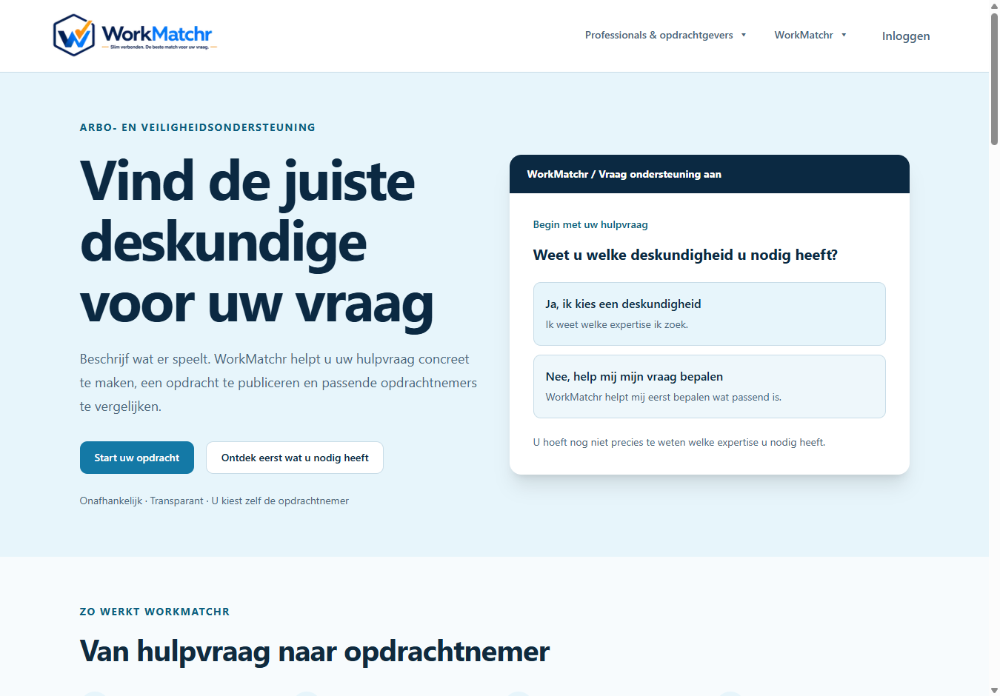
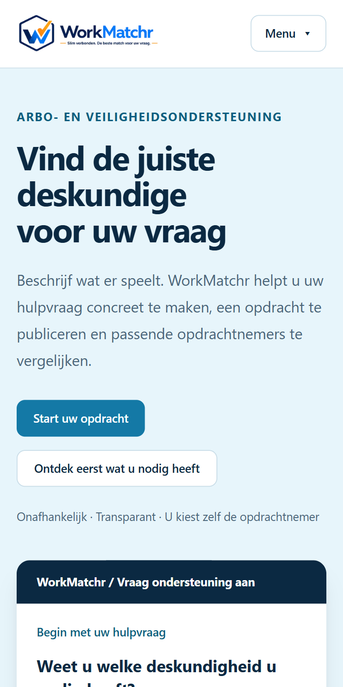
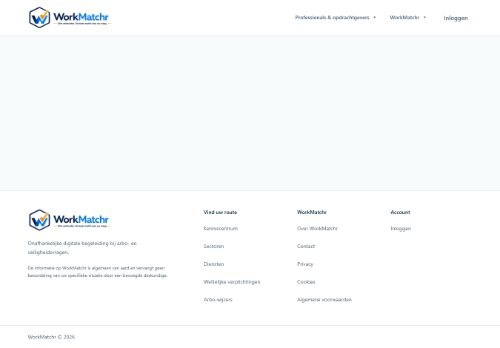

# P01 — homepage CLS en performance

## Scope en baseline

Onderzocht op 24 oktober 2026. Basis: `4cb6f5bc109c6c503ae7429c5ef426a4319ea8b8` (actuele main bij aanvang). Productie wees read-only gecontroleerd naar dezelfde commit: `dpl_GTNvu9dVgkD5njGBvXZrwQiq8jMr`. De reeds gemergede WP04–WP08-wijzigingen blijven behouden. P01 wijzigt geen lopende F3/F4/A07/LMS-branch en introduceert geen mergeafhankelijkheid op die pakketten.

## Gereproduceerde oorzaak

- Lighthouse 13.5.0 reproduceert desktop-CLS **0,552673** in drie opeenvolgende anonieme productieruns, overeenkomstig de aangeleverde 0,553.
- CDP met echte netwerkvertraging registreert desktop een layout-shift van **0,453191**, veroorzaakt door de footer. De andere viewport-/throttlecondities verklaren het verschil met Lighthouse.
- De algemene `src/app/loading.tsx` rendert alleen `NavigationPending`, dat zelf geen DOM-ruimte inneemt. Next.js toont deze lege fallback terwijl de pagina wordt gestreamd. De flexlayout laat de footer aanvankelijk binnen de viewport staan. Bij ontvangst van de homepage wordt de footer buiten beeld geduwd.
- Desktoptrace: header blijft **97,796875 px** hoog; logo blijft **230,390625 × 64,796875 px**. Main groeit van **416,203125** naar **4254,734375 px**. Footer stond op y=514 binnen een viewport van 940 px.
- Mobiele CDP-trace: header blijft **81,59375 px**, logo **172,796875 × 48,59375 px**; lege main is kort 0 px hoog. De footer verdwijnt bij ontvangst van de pagina, met een gemeten shift van **0,900365** zonder recente gebruikersinvoer. Een eerdere shift met `hadRecentInput=true` telt uitdrukkelijk niet mee voor CLS.
- Stylesheets en logo waren al geladen vóór de geregistreerde grote shift. Geen extern webfont, fontdownload, bannerinvoeging, logo-resize of runtime-/hydratatiefout als oorzaak aangetroffen. De pagina gebruikt de bestaande systeemfontfallbacks. Geen aanleiding om fonts of afbeeldingen te wijzigen.

## Gerichte wijziging

Alleen de homepage-main in de bestaande routebewuste `ApplicationChrome` reserveert één viewport met `min-h-screen`, ook zolang de lege loading boundary wordt getoond. Hierdoor blijft de footer onder de eerste viewport totdat de pagina beschikbaar is. De bestaande vertraagde navigatiefeedback, afhandeling bij voltooiing en fout-unmount blijven behouden. De uiteindelijke pagina, hero, header, footer, CTA's, metadata, huisstijl en routes veranderen niet. Geen nieuwe runtime- of ontwikkeldependency in package.json/lockfile.

De algemene loading boundary blijft ongewijzigd. Een gerichte regressietest bewaakt dat `/opdracht-starten`, `/advieswijzer`, `/inloggen` en `/contact` hun oorspronkelijke main-klasse houden. Daarnaast worden navigatie, accountchrome, loadingfeedback en beide opdrachtstartinstappen getest. De homepage is na laden al hoger dan de viewport; de reservering verandert daar de uiteindelijke geometrie niet in de gecontroleerde schermformaten.

## Reproduceerbare browserregressie

`scripts/check-homepage-cls.mjs` gebruikt native Node.js WebSocket/CDP en een afzonderlijk tijdelijk Chrome-profiel. Geen bestaande browserprofielen, accounts of cookies. Desktop 1350×940/DPR1 en mobiel 412×823/DPR1,75; cache uit, 150 ms netwerkvertraging, 200.000 bytes/s download en CPU×4. De controle berekent CLS volgens het grootste sessievenster en negeert verschuivingen na recente invoer. CLS >0,10, horizontale overflow of runtime-exceptions geven een fout. Screenshots en geanonimiseerde DOM-geometrie worden lokaal opgeslagen. Alleen het zelf aangemaakte browserprofiel wordt verwijderd.

```powershell
$env:CHROME_PATH = 'C:\Program Files\Google\Chrome\Application\chrome.exe'
node scripts/check-homepage-cls.mjs http://127.0.0.1:3050/ .local-storage/p01/after
```

## Meetvoorwaarden en beperkingen

Windows 11, Intel i7-1165G7 (4 cores/8 threads), 16 GiB RAM, Node 25.6.1, Chrome 155.0.8059.86 en Lighthouse 13.5.0. Afzonderlijke koude, anonieme browserprofielen zonder extensies; drie runs per schermformaat en reeks. De gecontroleerde voor-/nameting gebruikt dezelfde lokale production build-server op poort 3050, dezelfde main-basis en dezelfde omgeving. Geen gelijktijdige P01-builds of tests tijdens die reeksen. Overige gebruikersapplicaties zijn ongemoeid gelaten. Browsercache is koud; server-/imagecache kan na de eerste aanvraag warm zijn.

- Desktop: 1350 × 940, DPR 1; standaard Lighthouse-desktopconfiguratie, gesimuleerd RTT 40 ms, 10.240 Kbps, CPU ×1.
- Mobiel: 412 × 823, DPR 1,75; standaard Lighthouse-mobielconfiguratie, gesimuleerd RTT 150 ms, 1.638,4 Kbps, CPU ×4.
- De afzonderlijke CDP-regressie gebruikt echte netwerkvertraging en CPU ×4 voor beide schermformaten, zie hierboven.
- Alleen laboratoriumbewijs; geen RUM/CrUX-veldgegevens, geen productie-nameting en geen gegarandeerde score. Kleine reeksen blijven gevoelig voor hardware-/timingvariatie. Lokale snelheidswaarden zijn niet rechtstreeks vergelijkbaar met de aangeleverde productie-Lighthousemeting.

De eerste productiereeks liep deels tegelijk met installatie van geïsoleerde meetdependencies. Deze diagnostische reeks bewijst de CLS-regressie, maar is uitgesloten van de zuivere Performance-voor-/navergelijking.

## Alle afzonderlijke metingen

### Gecontroleerde lokale voor-/nameting

| Reeks | Scherm | Run | Performance | CLS | FCP ms | LCP ms | TBT ms | SI ms |
| --- | --- | ---: | ---: | ---: | ---: | ---: | ---: | ---: |
| local-before | desktop | 1 | 74 | 0,552673 | 659 | 1142 | 93 | 1461 |
| local-before | desktop | 2 | 73 | 0,552673 | 338 | 898 | 163 | 844 |
| local-before | desktop | 3 | 76 | 0,552673 | 322 | 842 | 108 | 678 |
| local-before | mobile | 1 | 63 | 0,000000 | 2128 | 4080 | 777 | 4561 |
| local-before | mobile | 2 | 40 | 0,900365 | 1109 | 4108 | 1006 | 2647 |
| local-before | mobile | 3 | 74 | 0,000000 | 1495 | 3078 | 868 | 1885 |
| local-after | desktop | 1 | 90 | 0,000000 | 380 | 951 | 192 | 1926 |
| local-after | desktop | 2 | 96 | 0,000000 | 386 | 923 | 139 | 1080 |
| local-after | desktop | 3 | 97 | 0,000000 | 318 | 880 | 131 | 1097 |
| local-after | mobile | 1 | 67 | 0,000000 | 1738 | 4161 | 737 | 2625 |
| local-after | mobile | 2 | 72 | 0,000000 | 1730 | 4244 | 510 | 2668 |
| local-after | mobile | 3 | 70 | 0,000000 | 1699 | 4239 | 573 | 2380 |

Accessibility, Best Practices en SEO zijn **100 in alle 12 lokale runs**. Geen Lighthouse-waarschuwingen.

| Mediaan van drie runs | Desktop vóór | Desktop na | Mobiel vóór | Mobiel na |
| --- | ---: | ---: | ---: | ---: |
| Performance | 74 | 96 | 63 | 70 |
| CLS | 0,552673 | 0 | 0 | 0 |
| Maximale CLS | 0,552673 | 0 | **0,900365** | 0 |
| FCP (ms) | 338 | 380 | 1495 | 1730 |
| LCP (ms) | 898 | 923 | 4080 | 4239 |
| TBT (ms) | 108 | 139 | 868 | 573 |
| Speed Index (ms) | 844 | 1097 | 2647 | 2625 |

De mobiele mediaan vóór herstel is misleidend als stabiliteitsmaat: twee runs misten het korte fallbackmoment, één run registreerde CLS 0,900365. Daarom staan ook de maximale CLS, alle individuele metingen en de vertraagde CDP-negatieve controle in het dossier. Na herstel is CLS in alle zes Lighthouse-runs en beide vertraagde CDP-runs 0. Niet alle snelheidsmaten verbeteren; de aantoonbare reparatie betreft layoutstabiliteit.

### Diagnostische productie-nulmeting (niet gebruikt als snelheidsvergelijking)

| Reeks | Scherm | Run | Performance | CLS | FCP ms | LCP ms | TBT ms | SI ms |
| --- | --- | ---: | ---: | ---: | ---: | ---: | ---: | ---: |
| production-before | desktop | 1 | 71 | 0,552673 | 364 | 783 | 206 | 1011 |
| production-before | desktop | 2 | 68 | 0,552673 | 408 | 771 | 254 | 1135 |
| production-before | desktop | 3 | 66 | 0,552673 | 440 | 917 | 251 | 1644 |
| production-before | mobile | 1 | 65 | 0,000000 | 1920 | 3555 | 1130 | 3348 |
| production-before | mobile | 2 | 67 | 0,000000 | 1285 | 2909 | 1686 | 3184 |
| production-before | mobile | 3 | 62 | 0,000000 | 1278 | 3580 | 1607 | 3599 |

Ook deze zes runs hebben Accessibility/Best Practices/SEO 100. Alle 18 runs, UTC-meettijden, benchmarkindices en exacte instellingen staan in [lighthouse-results.json](evidence/p01-homepage/lighthouse-results.json).

### Meting opnieuw uitvoeren

Gebruik een schone production build van de genoemde basis voor de nulmeting en van deze branch voor de nameting. Installeer Lighthouse 13.5.0 uitsluitend in een tijdelijke/ignored meetmap; wijzig geen projectdependencies. Draai per toestand drie desktop- en drie mobiele runs achtereen, zonder build/testbelasting, met een nieuw Chrome-profiel per run. Bijvoorbeeld met de Lighthouse-CLI uit die geïsoleerde installatie:

~~~powershell
$env:CHROME_PATH = 'C:\Program Files\Google\Chrome\Application\chrome.exe'
# Herhaal iedere opdracht driemaal met een unieke output-path.
lighthouse http://127.0.0.1:3050/ --preset=desktop --chrome-flags='--headless=new --disable-extensions' --output=json --output-path=.local-storage/p01/desktop-1.json
lighthouse http://127.0.0.1:3050/ --chrome-flags='--headless=new --disable-extensions' --output=json --output-path=.local-storage/p01/mobile-1.json
~~~

De uitgevoerde reeksen gebruikten dezelfde desktop/default-configuraties via de Lighthouse Node-API en Chrome Launcher. De dependencyvrije CDP-regressie hierboven bewaakt specifiek de footerregressie en faalt op de ongewijzigde productieversie (desktop 0,552673, mobiel 0,900365).

## Browseracceptatie en visueel bewijs

[Browserverificatie](evidence/p01-homepage/browser-acceptance.json): desktop 1350 × 940, tablet 800 × 940 en mobiel 390 × 940, telkens een nieuw anoniem profiel.

- Homepage HTTP 200; één h1 en correcte canonical.
- Geen horizontale overflow of browser-runtime-/hydratatie-exceptions.
- Toetsenbord: skiplink, zichtbare 3 px-focus, hero-CTA en mobiele navigatie. Menu opent met Enter en sluit met Escape; focus keert terug.
- Generieke opdrachtstart, deskundigheidsinstap, onderwerpinstap en legacy-redirect gecontroleerd. Bestaande keuze en eerste vervolgstap werken; er is geen opdracht gepubliceerd of account gebruikt.
- Alle 32 unieke interne homepagebestemmingen geven HTTP 200. Dit bewijst bereikbaarheid, niet alle achterliggende bedrijfsprocessen.
- [Vertraagde CDP-nameting](evidence/p01-homepage/local-after-layout-shifts.json): HTTP 200, CLS 0, geen overflow/exceptions voor beide schermformaten.
- De uiteindelijke **eerste-viewport** PNG's zijn vóór/na byte-identiek op desktop en mobiel. Desktop SHA256: 7ddf8eea04a6f06ced0c893717135a6bf7a156cdeefdf413612521610e88643e; mobiel: 94176eb9f404c0452b9397e949a6c8fc45c840b5eef5d8872d4095a191705806. Dit is geen claim dat iedere full-page-screenshot identiek is.
- [Eindgeometrie](evidence/p01-homepage/final-geometry.json): footer sluit in alle drie schermformaten direct aan op de laatste sectie; geen extra leeg vlak na de geladen hoofdinhoud.





## Technische validatie

- **90/90 tests in 13 bestanden PASS**: homepage v0.1/v0.2, opdrachtstartroute, header/branding/logout, applicatiechrome, publieke navigatie/interactie, loadingfeedback en Simple Advice-formulier.
- Volledige projectlint PASS: `npm run lint -- --ignore-pattern '.local-storage/**'`. Alleen ignored lokale meettools/artefacten uitgesloten; geen productcode uitgesloten. Nieuwe CDP-helper ook afzonderlijk gelint: PASS.
- Standalone `npx tsc --noEmit --incremental false`: **BASELINE_FAILURE**, exact vier bestaande TS2345-readonly-arrayfouten in `src/lib/compliance/rule-engine.test.ts` op regels 13, 14, 23 en 24. Bestand en compilerconfig ongewijzigd tegenover main; dezelfde vier zijn al gedocumenteerd in [WP04](wp04-public-acceptance.md). Geen P01-typefout.
- `npm run build`: PASS, Next.js 16.2.11, 163 routes. Bestaande NFT/workspace-rootwaarschuwing bij Knowledge-bronmanifest blijft afzonderlijk staan; niet door P01 geïntroduceerd.
- `git diff --check`: PASS.
- Gerichte secrets-patterncontrole van de definitieve 13 bestanden: PASS, nul treffers voor private keys, provider-/GitHub-tokens, databasecredentials, bearer/JWT en toegewezen authsecrets. Geen env-bestanden, credentials, cookies, sessies of persoonsgegevens opgenomen. Screenshots bevatten uitsluitend de publieke anonieme homepage.
- Geen database nodig: lokale server gebruikt een onbereikbare synthetische DB-configuratie; F4 en contactformulier uit, geen e-mailtransport naar een provider. Geen migratie, account, financiële handeling of productie-instelling gewijzigd.

## Open verbeterpunten en mergeadvies

**Technisch GO voor deze afgebakende CLS-reparatie.** CLS ≤0,10 is in alle gecontroleerde nametingen behaald, desktop Performance is 90/96/97. Accessibility, Best Practices en SEO blijven 100. De gerichte CSS-reservering wijzigt alleen de lege homepage-laadfase en raakt geen andere routes.

**De mobiele Performance-doelstelling ≥90 is niet behaald:** 67/72/70, mediaan 70. Het dossier is daarom geen volledige P01-performancevrijgave. Mobiele mediane LCP is 4,24 s en TBT 573 ms. In de tweede mobiele nameting is het LCP-element de hero-introductietekst; stijl/layout en scriptuitvoering kosten op de meetmachine veel main-threadtijd. Het grootste JavaScriptfragment bevat de gedeelde React-runtime (onder meer hydrateRoot/createRoot). Er is geen aangetoonde kleine, veilige verwijdering van homepagefunctionaliteit of runtime gevonden die deze resterende kosten oplost. Geen brede hydratatie-/bundelrefactor of onbewezen fontoptimalisatie uitgevoerd.

Een kleinere favicon en verdere mobiele CSS/JavaScriptprofilering zijn mogelijke vervolgonderzoeken; het huidige volledige logo wordt ook als favicon geladen. Er is geen geïsoleerd A/B-bewijs dat dit de resterende mobiele LCP verklaart. Daarom geen asset-/metadatawijziging in deze CLS-fix. Na een afzonderlijk goedgekeurde release moet productie opnieuw worden gemeten; de huidige resultaten vervangen geen velddata.

Actuele main bleef tijdens de eindcontrole op de genoemde basis. De open PR-bestandsinventaris bevat geen overlap met de twee gewijzigde ApplicationChrome-bestanden. P01 kan afzonderlijk worden gereviewd zonder WP12/F3/F4/A07/LMS over te nemen of hun vrijgave te wijzigen. Bij latere mainwijzigingen opnieuw controleren. Geen automatische merge of productie-deployment.

## Exacte wijzigingsset

- src/components/layout/application-chrome.tsx
- src/components/layout/application-chrome.test.tsx
- scripts/check-homepage-cls.mjs
- docs/p01-homepage-performance.md
- docs/evidence/p01-homepage/before-footer.jpg
- docs/evidence/p01-homepage/before-content.jpg
- docs/evidence/p01-homepage/after-desktop.png
- docs/evidence/p01-homepage/after-mobile.png
- docs/evidence/p01-homepage/production-layout-shifts.json
- docs/evidence/p01-homepage/local-after-layout-shifts.json
- docs/evidence/p01-homepage/browser-acceptance.json
- docs/evidence/p01-homepage/final-geometry.json
- docs/evidence/p01-homepage/lighthouse-results.json

Geen wijziging aan loading.tsx, homepagecopy, metadata, prijzen, juridische content, marketplacebeslisregels, auth, database, package.json of lockfile. Rollback kan later via het terugdraaien van alleen deze commit; geen dataherstel nodig.

## Methodische bronnen en bewijs

- [Google: definitie en sessievenster van CLS](https://web.dev/articles/cls).
- [Chrome: Lighthouse-scores en meetvariatie](https://developer.chrome.com/docs/lighthouse/performance/performance-scoring).
- [Productie-CDP-geometrie en verschuivingen](evidence/p01-homepage/production-layout-shifts.json): uitsluitend publieke elementen, geen sessiegegevens.

De opeenvolgende beelden uit dezelfde desktoptrace tonen eerst de footer binnen de eerste viewport en daarna de binnengekomen pagina:




De volledige Lighthouse-rapporten en Chrome-traces blijven lokaal in de genegeerde meetmap. De compacte individuele meetwaarden, instellingen, medianen en browserbewijzen zijn hierboven versieerbaar opgenomen.
