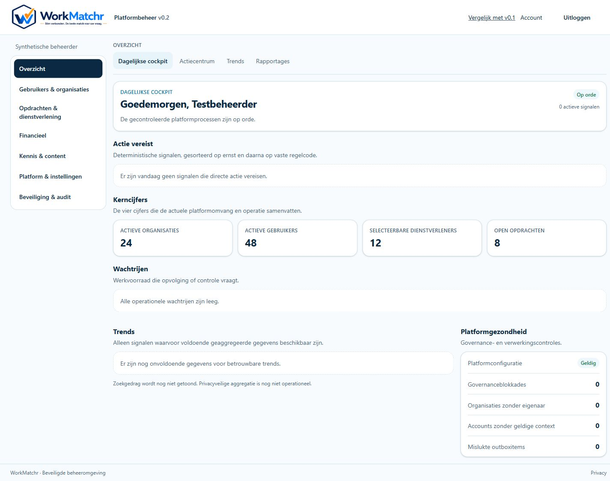
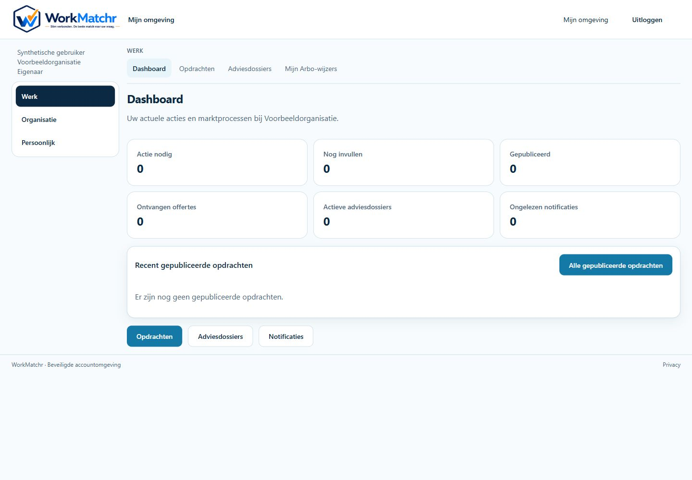
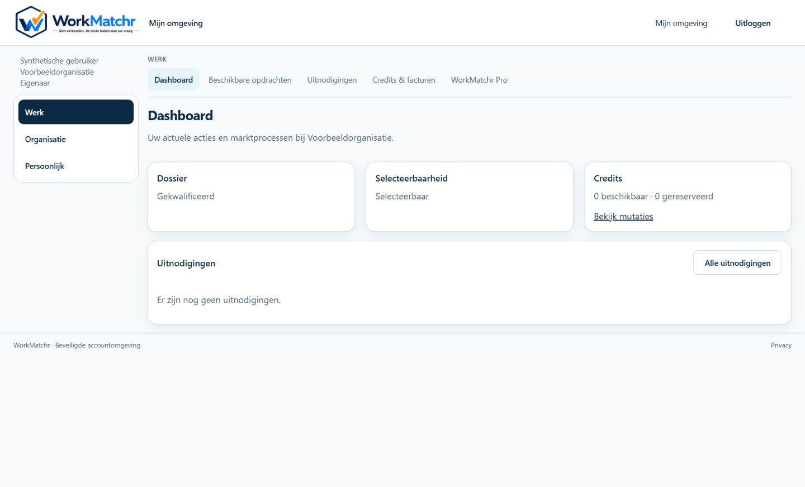
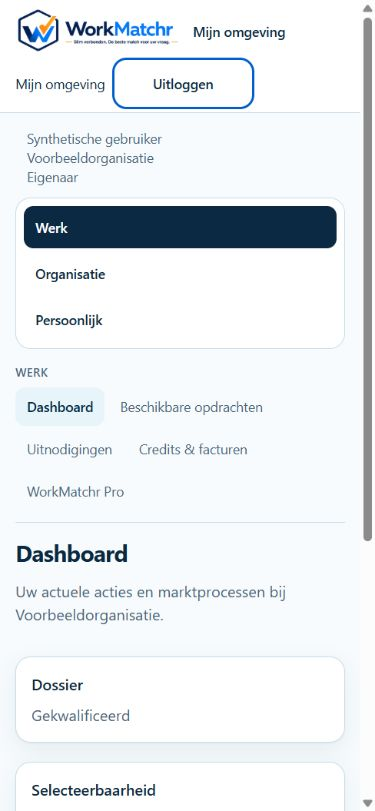

# Gedeelde WorkMatchr-werkruimte — issue #22

Basis: main cb314d7, inclusief PR #21, #23 en #24. Dit vervolgbesluit vervangt de CSS-benadering uit A01.7: de echte Platformbeheer-v0.2-shell wordt nu hergebruikt.

## Componenten en behoud

- `WorkspaceShell` bezit de bestaande beheerheader, 14rem hoofdstukkolom, subnavigatie, 100rem breedte, 1rem tussenruimte, footer en focusstijlen.
- `workspace-shell.module.css` is de ongewijzigde oorspronkelijke beheer-contentstylesheet. De oude CSS-module blijft als compatibiliteitsalias bestaan.
- `PlatformAdminShellV02` levert uitsluitend de bestaande beheerhoofdstukken, actieve route, identiteit, versie-/accountlinks en testaccountwisselaar aan deze component.
- `AccountWorkspaceShell` gebruikt exact diezelfde shell. De menu-inhoud komt uitsluitend uit het bestaande servergeleverde HeaderViewModel. Werk, Organisatie en Persoonlijk blijven de bestaande groepen; hun bestaande links staan als subnavigatie boven de inhoud. De langste bestaande route bepaalt de actieve link.
- ApplicationChrome vervangt in de standaard accountwerkruimte de oude header, accordeonzijbalk en afwijkende grid door AccountWorkspaceShell. Ook een beheerder op een gewone accountwerkroute krijgt de gedeelde shell. Publieke routes en de afzonderlijke beheerroute blijven via de bestaande routering lopen.
- De oude account-shell blijft uitsluitend voor de bestaande expliciete rollbackinstellingen beschikbaar. AccountNavigationMenu/AccordionNavigation zijn geen onderdeel meer van de standaard accountwerkruimte; hun gebruik in de publieke header en legacyvariant blijft behouden.
- De bestaande LogoutButton staat eenmaal in de gedeelde header. Mijn omgeving staat bij gewone accounts direct links daarvan. Geen authenticatie-, sessie-, autorisatie-, tenant-, actie-, formulier-, query-, route- of databasewijziging.
- Bestaande Section/Container-padding wordt alleen binnen de accountinhoud opgeheven om dubbele buitenmarges te voorkomen. Bestaande kaarten worden compact gepresenteerd; inhoud en controls blijven aanwezig.

## Visuele vergelijking

Referentie: eerder vastgelegde Platformbeheer-v0.2-overzichtscreenshot. Daarnaast is de volledige gerenderde beheermarkup rechtstreeks vergeleken met de ongewijzigde main-component: identiek, uitgezonderd het nieuwe data-workspace-shell-testattribuut. Dit resultaat is als regressiesnapshot vastgelegd.

De onderstaande screenshots gebruiken echte shell- en dashboardcomponenten met fictieve querygegevens, geen echte login of tenantdata.

| Kenmerk bij 1440px | Beheer | Opdrachtgever | Dienstverlener |
| --- | --- | --- | --- |
| Headerhoogte | 81,675px | 81,675px | 81,675px |
| Zijbalk | 224px / 14rem | 224px / 14rem | 224px / 14rem |
| Hoofdstukstijl | Marine actief, wit paneel | Identiek | Identiek |
| Subnavigatie | Boven inhoud | Identiek | Identiek |
| Horizontale pagina-overflow | Nee | Nee | Nee |

Menuopties, organisatie-/rolcontext en inhoud verschillen bewust. De beheermarkup en oorspronkelijke compactheidsregels zijn behouden.

### Platformbeheer

### Opdrachtgever

### Dienstverlener

### Mobiel en toetsenbordfocus

## Validatie

- Definitieve suite: 104/104 tests PASS in 21 bestanden, inclusief beheerdefault/versiekeuze, gedeelde-shellsnapshot en bestaande autorisatie/policytests.
- Tests doorlopen alle bestaande accountlinks voor CLIENT/PROFESSIONAL en OWNER/ADMIN/MEMBER, meest specifieke actieve route, ongewijzigd formulier, organisatiecontext, geen beheerlinks bij gewone accounts en platformrolfiltering. Bestaande serverautorisatie- en organisatiepolicytests inbegrepen.
- Desktop 1440px, tablet 820px en mobiel 390px visueel/DOM gecontroleerd voor de drie omgevingen. Geen horizontale pagina-overflow. Mobiele navigatie is permanent bereikbaar en gebruikt dezelfde gestapelde hoofdstukken als beheer. Focus op Uitloggen zichtbaar; native links, button en aria-current blijven aanwezig.
- Dit is componentacceptatie. Definitieve Product Owner-acceptatie, echte sessie-/tenant-E2E en een nieuwe echte 200%-zoomcontrole zijn nog niet uitgevoerd. Eerdere zoomacceptatie wordt niet als bewijs voor deze wijziging hergebruikt.
- Productiebuild PASS. Standalone TypeScript: uitsluitend vier bekende TS2345 readonly-arraybaselinefouten in src/lib/compliance/rule-engine.test.ts (13:79, 14:89, 23:8, 24:89); dit bestand is identiek aan origin/main. Geen nieuwe TypeScript-fouten uit de taakbestanden. Volledige lint ook op de definitieve wijzigingsset PASS. Diff-check en secrets-patterncontrole PASS.

## Release en rollback

Geen automatische merge of productiepublicatie. Eerst Draft PR review en visuele Product Owner-acceptatie; resterende rode baselinechecks volgens de bestaande repositoryprocedure beoordelen. Daarna uitsluitend de geaccepteerde commit via de normale releaseprocedure uitrollen; geen migratie nodig.

Rollback: revert uitsluitend deze wijzigingscommit om exact PR #24-layout terug te krijgen. De bestaande `NEXT_PUBLIC_ACCOUNT_LAYOUT_VERSION=legacy` en `NEXT_PUBLIC_ACCOUNT_SHELL_VERSION=v01` blijven technische alternatieven, maar een wijziging daarvan vereist een aparte gecontroleerde rebuild/release. Er zijn nu geen omgevingswaarden gewijzigd. Platformbeheer kiest voortaan v0.2 zonder voorkeur; de expliciete v01-cookie blijft de bestaande vergelijkingsshell tonen. Cookiebeveiliging en autorisatie blijven ongewijzigd.

## Exacte gewijzigde bestanden

- `docs/README.md`
- `docs/screenshots/shared-workspace-shell/admin.png`
- `docs/screenshots/shared-workspace-shell/client.png`
- `docs/screenshots/shared-workspace-shell/provider-mobile.png`
- `docs/screenshots/shared-workspace-shell/provider.png`
- `docs/shared-workspace-shell.md`
- `src/app/platformbeheer/layout.test.tsx`
- `src/app/platformbeheer/layout.tsx`
- `src/components/layout/__snapshots__/workspace-shell.test.tsx.snap`
- `src/components/layout/account-navigation-integration.test.tsx`
- `src/components/layout/account-shell-v02.test.tsx`
- `src/components/layout/account-workspace-content.module.css`
- `src/components/layout/account-workspace-shell.tsx`
- `src/components/layout/application-chrome.test.tsx`
- `src/components/layout/application-chrome.tsx`
- `src/components/layout/header-logout.test.tsx`
- `src/components/layout/uniform-account-shell.test.tsx`
- `src/components/layout/workspace-shell.module.css`
- `src/components/layout/workspace-shell.test.tsx`
- `src/components/layout/workspace-shell.tsx`
- `src/components/platform-admin/platform-admin-shell-v02.tsx`
- `src/components/platform-admin/platform-admin-v02.module.css`
